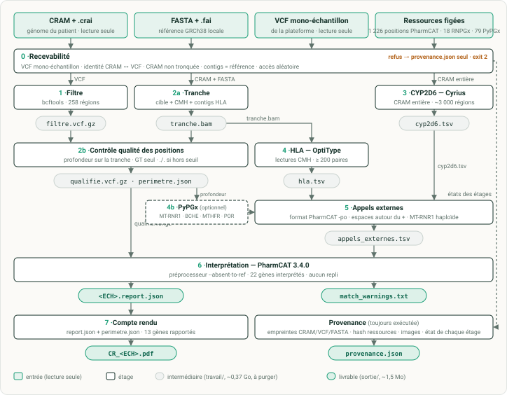
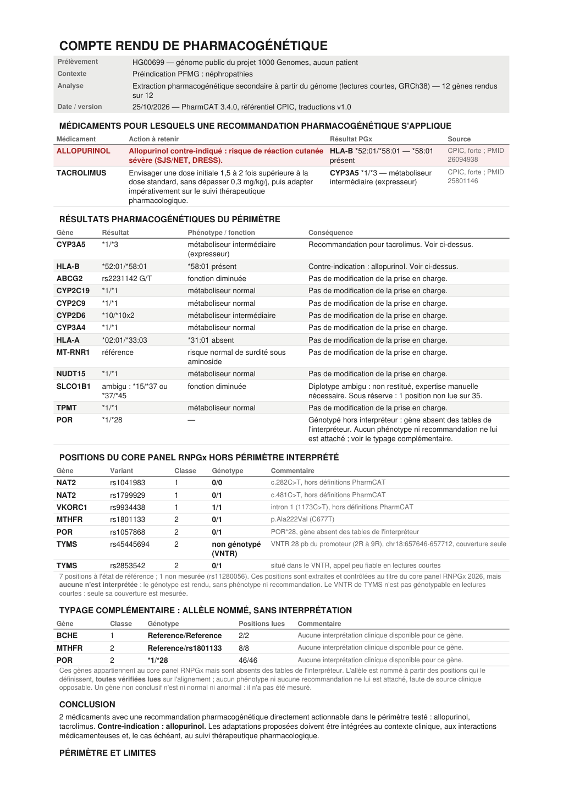

# pgx-genome

Module de pharmacogénétique pour génome entier. Il lit un génome déjà séquencé et
aligné, et rend un avis pharmacogénétique sur treize gènes. Il ne demande ni
nouveau prélèvement, ni nouvelle course de séquençage, ni réalignement, ni second
appel de variants : il se branche en aval d'un pipeline de séquençage existant.

Règle de conception unique : **aucun résultat faux ne sort sans être signalé**.
Chaque étage teste son code de retour, inscrit son état, et refuse de se rabattre
sur une entrée de secours. Le code de retour du module ne vaut zéro que si les
neuf étages requis ont abouti.

## Ce qu'il fait

À partir d'un alignement (CRAM ou BAM) et d'un fichier de variants (VCF), il
produit pour un génome :

| Sortie | Contenu |
|---|---|
| `sortie/<ECH>.report.json` | l'avis complet, structuré, exploitable par une machine |
| `sortie/CR_<ECH>.pdf` | le compte rendu en français, médicaments concernés en tête |
| `sortie/provenance.json` | la trace d'exécution : entrées, empreintes, versions, seuils, état de chaque étage |

Il couvre le sous-ensemble néphrologie et épilepsie du panel socle RNPGx 2026 :
CYP2C9, CYP2C19, CYP2D6, CYP3A4, CYP3A5, SLCO1B1, TPMT, NUDT15, ABCG2, MT-RNR1,
POR, HLA-A et HLA-B. Quatre outils font le travail biologique, orchestrés par un
script bash :

| Étape | Outil |
|---|---|
| CYP2D6 (duplications, hybrides) | Cyrius, sur l'alignement complet |
| HLA de classe I | OptiType, sur les lectures du complexe majeur |
| MT-RNR1, BCHE, MTHFR, POR | PyPGx, sur les régions de ces gènes (étage 4b, optionnel) |
| Les autres gènes et l'interprétation | PharmCAT |

Un contrôle qualité, en amont de l'interpréteur, distingue « position lue,
identique à la référence » de « position non séquencée » : sans lui, PharmCAT
rendrait un génotype de référence sur une position simplement absente du
fichier. Un génome dont la couverture médiane sur le périmètre est inférieure à
18 × est refusé ; un échantillon dont les hétérozygotes sont déséquilibrés au-delà
de 35 % aussi. Les 18 positions de classe 1 et 2 du core panel absentes des
définitions de l'interpréteur (BCHE, MTHFR, GGCX, TYMS, NAT2, VKORC1, cluster
CYP2C…) sont extraites, contrôlées et rendues en génotype, jamais interprétées.

<p align="center"></p>

## Validation

Mesurée sur les génomes publics du 1000 Genomes Project (jeu haute couverture
NYGC, GRCh38), contre les diplotypes de référence **GeT-RM** (CDC) et le typage
HLA par séquençage Sanger (Gourraud *et al.*, 2014). Le détail, les limites et le
protocole de revalidation sont dans `doc/VALIDATION.md`.

| Mesure | Résultat | § |
|---|---|---|
| Génomes soumis, refusés à l'entrée, recevables, menés au bout | 256, 13, 243, **242** | 3.2 |
| Concordance sur les dix gènes à vérité | **1000 / 1009 = 99,1 %** ; 100 % sur les huit gènes à allèles étoile | 3.1 |
| Allèles HLA à risque (A\*31:01, B\*15:02, B\*57:01, B\*58:01, B\*15:11) | **81 porteurs sur 81 retrouvés, 0 faux positif** | 3.1 |
| Domaine de validité en couverture | aucun allèle à conséquence clinique perdu jusqu'à 18 × ; neuf faux appels à 11 × | 3.4 |
| Indépendance à l'appeleur de variants | 103 683 positions, 99,924 % ; aucun écart de phénotype ni de recommandation sur 29 génomes | 3.5 |
| Mélange d'échantillons | refusé à 30 %, **non détecté à 20 %** : un contrôle de contamination reste nécessaire en amont | 3.7 |
| Débit, 24 cœurs | 51 génomes par heure par la recette Nextflow, 39 par le lot à six | 3.10 |

<p align="center"></p>

Les neuf écarts portent tous sur le second champ d'un allèle HLA, sans
conséquence de prescription. POR et ABCG2 sont dans le périmètre sans vérité sur
ce banc, et MT-RNR1 n'y a aucun porteur : son appel positif n'est exercé que par
un cas construit. Les traductions des recommandations CPIC n'ont pas de
validation pharmacologique.

## Prérequis

| Dépendance | Version | Rôle |
|---|---|---|
| Linux | — | l'environnement ; WSL2 convient pour un poste |
| `bash` | ≥ 4 | l'orchestrateur |
| `docker`, ou `apptainer` / `singularity` | — | les conteneurs ; `PGX_MOTEUR` choisit le moteur (`docker` par défaut) |
| `samtools` | ≥ 1.13 | tranche, profondeur, extraction du complexe majeur |
| `python3` | ≥ 3.8, avec `reportlab` | contrôle qualité, provenance, compte rendu |
| GNU coreutils, findutils | — | `stat -c`, `xargs -d` |
| dépôt Cyrius | commit `7c060db` | l'étage CYP2D6, avec ses propres dépendances Python |
| image PyPGx et sa ressource de données | 0.27.0 | l'étage 4b, optionnel ; image construite sur place |
| Nextflow | ≥ 25.04 | optionnel, pour la recette `exemples/pgx_genome.nf` |

Trois images sont épinglées par étiquette et par empreinte immuable dans
`env/conteneurs.txt` ; la quatrième se construit sur place. Un changement de
version change les résultats et doit être remesuré.

Deux ressources externes, non versionnées : **la référence GRCh38** qui a servi
à l'alignement, indexée (ce banc : `GRCh38_full_analysis_set_plus_decoy_hla.fa`),
et **le dépôt Cyrius**, épinglé.

## Installation

```bash
git clone <url-de-ce-depot> pgx-genome
cd pgx-genome
pip install -r env/requirements.txt

# Cyrius, épinglé
git clone https://github.com/Illumina/Cyrius.git /opt/Cyrius
git -C /opt/Cyrius checkout 7c060db
pip install -r /opt/Cyrius/requirements.txt

# les trois images publiées (empreintes dans env/conteneurs.txt)
docker pull quay.io/biocontainers/bcftools:1.24--h118bc1c_2
docker pull pgkb/pharmcat:3.4.0
docker pull quay.io/biocontainers/optitype:1.3.5--hdfd78af_3

# l'étage 4b : image construite sur place, ressource de données à part
docker build -f env/pypgx.Dockerfile -t pgx-genome/pypgx:0.27.0 env
git clone --branch 0.27.0 https://github.com/sbslee/pypgx-bundle.git /opt/pypgx-bundle
```

```bash
export PGX_FASTA=/chemin/GRCh38_full_analysis_set_plus_decoy_hla.fa
export PGX_CYRIUS=/opt/Cyrius
export PGX_IMG_PYPGX=pgx-genome/pypgx:0.27.0   # absent : étage 4b ignoré
export PYPGX_BUNDLE=/opt/pypgx-bundle
```

La mise en service sur une plateforme — contrôle des empreintes, tests, génome
de qualification — est décrite dans `doc/MODE_EMPLOI.md`, § 11.

## Utilisation

Un génome :

```bash
bin/pgx_genome.sh \
  --cram    /chemin/echantillon.cram \
  --vcf     /chemin/echantillon.vcf.gz \
  --sortie  /chemin/resultats/echantillon \
  --echantillon ECH001 \
  --identite /chemin/identite.json
```

Le fichier d'identité porte `patient`, `naissance` et `contexte` (la
préindication). Il passe par un chemin, jamais par des arguments : un argument
est lisible dans la table des processus et dans les journaux de l'ordonnanceur.
Sans identité, le document porte la mention « prototype ».

Un lot, avec tableau de bord :

```bash
bin/pgx_lot.sh --manifeste liste.tsv --sortie /chemin/resultats --parallele 6
```

Le manifeste porte trois colonnes séparées par des tabulations : identifiant,
chemin de l'alignement, chemin du fichier de variants (`exemples/manifeste.exemple.tsv`).
Un génome n'occupe que 1,3 cœur en moyenne : le débit tient au nombre de génomes
menés de front, mesuré jusqu'à six. `exemples/pgx_genome.nf` est une recette
Nextflow, un processus par étage, qui déclare les cœurs et la mémoire mesurés.

Les options complètes sont dans `doc/MODE_EMPLOI.md`, § 7.

## Entrées, sorties, contrat

| Entrée | Contrainte |
|---|---|
| Alignement | CRAM ou BAM indexé, GRCh38, le même que celui du rendu diagnostique |
| Variants | VCF d'un seul échantillon, GRCh38, avec `GT`, `GQ`, `DP` |
| Référence | FASTA indexé, celle de l'alignement, obligatoire pour un CRAM |

| Code de retour | Signification |
|---|---|
| `0` | les neuf étages requis ont abouti ; `reussite_complete` est vrai dans `provenance.json` |
| `1` | au moins un étage en échec ; à instruire gène par gène |
| `2` | génome refusé — à l'entrée, ou après le contrôle qualité — ou configuration invalide ; **aucun compte rendu** |
| `3` | une autre exécution travaille dans le même dossier |

Exemple de compte rendu, contexte « néphropathies » : HG00699, génome public,
porteur de HLA-B\*58:01 et de CYP3A5 \*1/\*3.

<p align="center"></p>

## Ce que le module ne fait pas

- **POR, BCHE et MTHFR** sont rendus en allèle nommé, sans phénotype ni
  recommandation : l'interpréteur n'a pas de table pour eux.
- **Les remaniements de structure** ne sont analysés que pour CYP2D6.
- **Seuls les allèles répertoriés** au catalogue de référence sont recherchés ;
  un variant délétère non répertorié donne un métaboliseur normal.
- **Un mélange d'échantillons de 20 %** n'est pas détecté.
- Le module **prépare, il ne signe pas** : la validation biologique reste au
  biologiste médical.

## Structure du dépôt

```
bin/            les neuf scripts du pipeline
ressources/     les ressources figées, lues à l'exécution (dont les traductions CPIC)
outils/         les générateurs de ressources, les contrôles, les crochets
tests/          247 cas, audités par mutation
doc/            mode d'emploi, flux de fichiers, dossier de validation, figures
env/            dépendances Python, empreintes des conteneurs, image PyPGx
exemples/       un manifeste type, une recette Nextflow
bench/          la liste des prélèvements du banc et la fiche de résultats par gène
```

`doc/MODE_EMPLOI.md` est le manuel de référence, étage par étage, avec la
justification de chaque garde-fou. `doc/FLUX_FICHIERS.md` décrit le cheminement
des fichiers. `doc/VALIDATION.md` rassemble les preuves, les limites à déclarer
et le protocole de revalidation.

## Licence

[PolyForm Strict 1.0.0](https://polyformproject.org/licenses/strict/1.0.0) — © 2026 Victor Marin.
Usage non commercial uniquement ; ni modification ni redistribution. Voir `LICENSE`
et, pour les composants tiers (MPL-2.0), `NOTICE`.
