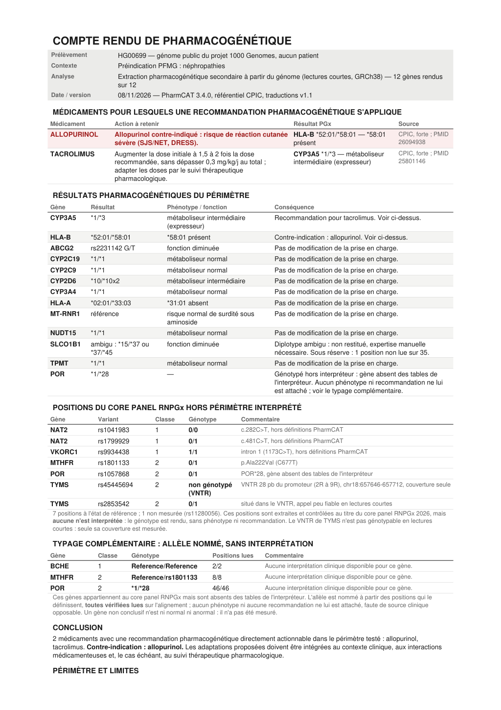
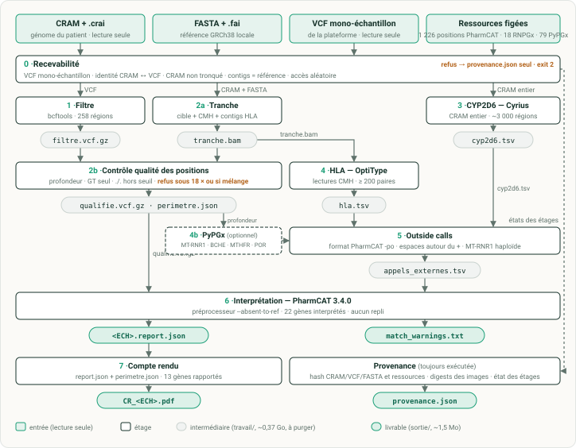
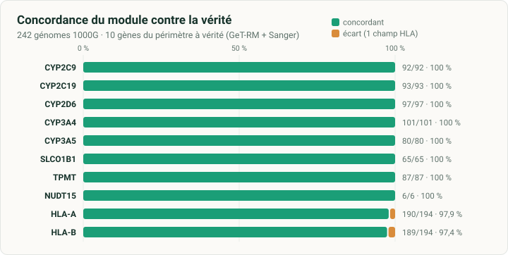

# pgx-genome

[](https://github.com/victormar1/pgx-genome/actions/workflows/ci.yml)

Un avis pharmacogénétique tiré d'un génome **déjà séquencé** : ni nouveau
prélèvement, ni nouvelle course, ni réalignement. Le module se branche en aval
du pipeline de séquençage de la plateforme et rend, pour treize gènes du panel
socle RNPGx 2026 (sous-ensemble néphrologie et épilepsie), les recommandations
CPIC qui modifient la prise en charge.

| Médicaments | Gènes | Ce que le compte rendu peut dire |
|---|---|---|
| allopurinol | HLA-B\*58:01 | contre-indication, risque de réaction cutanée sévère |
| carbamazépine, oxcarbazépine, phénytoïne | HLA-B\*15:02, HLA-A\*31:01, CYP2C9 | contre-indication ou adaptation de dose |
| abacavir | HLA-B\*57:01 | contre-indication |
| tacrolimus | CYP3A5 | dose initiale majorée chez l'expresseur |
| azathioprine, mercaptopurine | TPMT, NUDT15 | réduction de dose ou alternative |
| clopidogrel, IPP, antidépresseurs | CYP2C19, CYP2D6 | alternative ou adaptation |
| codéine, tramadol | CYP2D6 | éviter chez le métaboliseur ultrarapide ou lent |
| statines | SLCO1B1, ABCG2, CYP2C9 | dose ou molécule |
| aminosides | MT-RNR1 | éviter, risque de surdité définitive |

Règle de conception : **aucun résultat faux ne sort sans être signalé**. Une
position non lue n'est jamais prise pour une référence ; un génome hors du
domaine validé est refusé plutôt que rendu avec une réserve. Le module prépare,
il ne signe pas : la validation biologique reste au biologiste médical.

## Ce qu'il rend

À partir d'un alignement (CRAM ou BAM) et d'un fichier de variants, pour un
génome :

| Sortie | Contenu |
|---|---|
| `sortie/CR_<ECH>.pdf` | le compte rendu en français, médicaments concernés en tête |
| `sortie/<ECH>.report.json` | l'avis complet, structuré, exploitable par une machine |
| `sortie/provenance.json` | la trace d'exécution : hash des entrées, digests des images, versions, seuils, état de chaque étage |

Exemple, contexte « néphropathies » : HG00699, génome public, porteur de
HLA-B\*58:01 et de CYP3A5 \*1/\*3.

<p align="center"></p>

Le périmètre est le sous-ensemble néphrologie et épilepsie du panel socle RNPGx
2026 : CYP2C9, CYP2C19, CYP2D6, CYP3A4, CYP3A5, SLCO1B1, TPMT, NUDT15, ABCG2,
MT-RNR1, POR, HLA-A et HLA-B. Quatre outils font le travail biologique, un
script bash les orchestre.

| Gènes | Outil |
|---|---|
| CYP2D6, avec ses duplications et ses hybrides | Cyrius, sur l'alignement complet |
| HLA de classe I | OptiType, sur les lectures du complexe majeur |
| MT-RNR1, BCHE, MTHFR, POR | PyPGx, sur la région de ces gènes (étage optionnel) |
| les autres gènes, et l'interprétation | PharmCAT |

Entre l'alignement et l'interpréteur, un contrôle qualité sépare « position lue,
identique à la référence » de « position non séquencée » : sans lui, PharmCAT
rend un génotype de référence sur une position simplement absente du fichier. Il
écarte les génotypes qui ne tiennent pas le seuil de qualité, et refuse le génome
dont la couverture médiane du périmètre descend sous 18 ×, ou dont plus de 35 %
des hétérozygotes sont déséquilibrés.

S'y ajoutent les 18 positions de classe 1 et 2 du core panel que l'interpréteur
ne connaît pas (BCHE, MTHFR, GGCX, TYMS, NAT2, VKORC1, cluster CYP2C…) :
mesurées et rendues en génotype, jamais interprétées.

<p align="center"></p>

## Validation

Mesurée sur les génomes publics du 1000 Genomes Project (jeu haute couverture
NYGC, GRCh38), contre les diplotypes de référence **GeT-RM** (CDC) et le typage
HLA par séquençage Sanger (Gourraud *et al.*, 2014). Le détail, les limites et le
protocole de revalidation sont dans `doc/VALIDATION.md`.

| Mesure | Résultat | § |
|---|---|---|
| Génomes soumis, refusés à l'entrée, recevables, menés au bout | 256, 13, 243, **242** | 3.2 |
| Concordance sur les dix gènes à vérité | **1000 / 1009 = 99,1 %** ; 100 % sur les huit gènes à allèles étoile | 3.1 |
| Allèles HLA à risque (A\*31:01, B\*15:02, B\*57:01, B\*58:01, B\*15:11) | **81 porteurs sur 81 retrouvés, 0 faux positif** | 3.1 |
| ABCG2 et POR, absents de GeT-RM, contre une puce de génotypage | **228 / 228** et **204 / 204** concordants | 4.2 |
| MT-RNR1, porteurs réels de m.1095T>C | **2 sur 2** rendus à risque, « éviter les aminosides » au compte rendu | 4.1 |
| Domaine de validité en couverture | aucun allèle à conséquence clinique perdu jusqu'à 18 × ; neuf faux appels à 11 × | 3.4 |
| Indépendance au variant caller | 103 683 positions, 99,924 % ; aucun écart de phénotype ni de recommandation sur 29 génomes | 3.5 |
| Mélange d'échantillons | refusé à 30 %, **non détecté à 20 %** : un contrôle de contamination reste nécessaire en amont | 3.7 |
| Débit, 24 cœurs | 51 génomes par heure par la recette Nextflow, 39 par le lot à six | 3.10 |

<p align="center"></p>

Les neuf écarts portent tous sur le second champ d'un allèle HLA, sans
conséquence de prescription. Pour MT-RNR1, m.1555A>G et m.1494C>T n'ont aucun
porteur disponible : leur appel positif n'est exercé que par un contrôle positif synthétique.

`bench/` porte l'outillage qui refait ces mesures depuis les données publiques.
Une plateforme peut les reproduire chez elle, et doit le faire après tout
changement de version (`bench/LISEZMOI.md`).

## Mise en service

Linux, `bash` 4, `samtools` 1.13, `python3` 3.8 avec `reportlab`, et un moteur de
conteneurs — Docker, ou Apptainer par `PGX_MOTEUR`. Trois ressources ne sont pas
dans le dépôt : la référence GRCh38 indexée qui a servi à l'alignement, le dépôt
Cyrius épinglé, et la ressource de données de PyPGx.

```bash
git clone <url-de-ce-depot> pgx-genome
cd pgx-genome
pip install -r env/requirements.txt
```

Les quatre conteneurs sont épinglés par tag et par digest dans
`env/conteneurs.txt` ; un changement de version change les résultats et doit être
remesuré. La procédure complète — images, Cyrius, variables d'environnement, puis
qualification de l'installation sur un génome public — est dans
`doc/MODE_EMPLOI.md`, § 1. Elle se termine par **0 écart** attendu contre un
rapport de référence.

## Utilisation

Un génome :

```bash
bin/pgx_genome.sh \
  --cram    /chemin/echantillon.cram \
  --vcf     /chemin/echantillon.vcf.gz \
  --sortie  /chemin/resultats/echantillon \
  --echantillon ECH001 \
  --identite /chemin/identite.json
```

Le fichier d'identité porte `patient`, `naissance` et `contexte` (la
préindication). Il passe par un chemin, jamais par un argument, qui serait
lisible dans la table des processus. Sans identité, le document porte la mention
« prototype ».

Un lot, avec tableau de bord :

```bash
bin/pgx_lot.sh --manifeste liste.tsv --sortie /chemin/resultats --parallele 6
```

Le manifeste porte trois colonnes séparées par des tabulations : identifiant,
chemin de l'alignement, chemin du fichier de variants
(`exemples/manifeste.exemple.tsv`). Un génome n'occupe que 1,3 cœur en moyenne :
le débit tient au nombre de génomes menés de front.
`exemples/pgx_genome.nf` est une recette Nextflow, un processus par étage, qui
déclare les cœurs et la mémoire mesurés. Les options complètes sont dans
`doc/MODE_EMPLOI.md`, § 3.

## Entrées et codes de retour

| Entrée | Contrainte |
|---|---|
| Alignement | CRAM ou BAM indexé, GRCh38, le même que celui du rendu diagnostique |
| Variants | VCF d'un seul échantillon, GRCh38, avec `GT`, `GQ`, `DP` |
| Référence | FASTA indexé, celle de l'alignement, obligatoire pour un CRAM |

| Code | Signification |
|---|---|
| `0` | les neuf étages requis ont abouti ; `reussite_complete` est vrai dans `provenance.json` |
| `1` | au moins un étage en échec ; à instruire gène par gène |
| `2` | génome refusé — à l'entrée, ou après le contrôle qualité — ou configuration invalide ; **aucun compte rendu** |
| `3` | une autre exécution travaille dans le même dossier |

## Limites

Le module cherche des allèles répertoriés : un variant délétère absent du
catalogue de référence donne un métaboliseur normal. Les remaniements de
structure ne sont lus que pour CYP2D6. POR, BCHE et MTHFR sortent en allèle
nommé, sans phénotype ni recommandation, l'interpréteur n'ayant pas de table pour
eux. Et un mélange de deux échantillons à 20 % n'est pas détecté, alors qu'il
change le document rendu : un contrôle de contamination en amont reste
nécessaire.

## Structure du dépôt

```
bin/            les neuf scripts du pipeline
ressources/     les ressources figées, lues à l'exécution (dont les traductions CPIC)
outils/         les générateurs de ressources, les contrôles, les hooks
tests/          257 cas, vérifiés par mutation testing
doc/            mode d'emploi, flux de fichiers, dossier de validation, glossaire, figures
env/            dépendances Python, digests des conteneurs, image PyPGx
exemples/       un manifeste type, une recette Nextflow
bench/          l'outillage qui refait la validation, ses vérités, le génome de qualification
.github/        la CI : tests, contrôles du dépôt, messages de commit
```

`doc/MODE_EMPLOI.md` est le manuel : mise en service, exploitation, puis étage
par étage avec la justification de chaque garde-fou. `doc/FLUX_FICHIERS.md` suit
les fichiers un à un. `doc/VALIDATION.md` rassemble les preuves, les limites à
déclarer et le protocole de revalidation. `doc/GLOSSAIRE.md` définit le
vocabulaire du module.

## Licence

[PolyForm Strict 1.0.0](https://polyformproject.org/licenses/strict/1.0.0) — © 2026 Victor Marin.
Usage non commercial uniquement ; ni modification ni redistribution. Voir `LICENSE`
et, pour les composants tiers (MPL-2.0), `NOTICE`.
