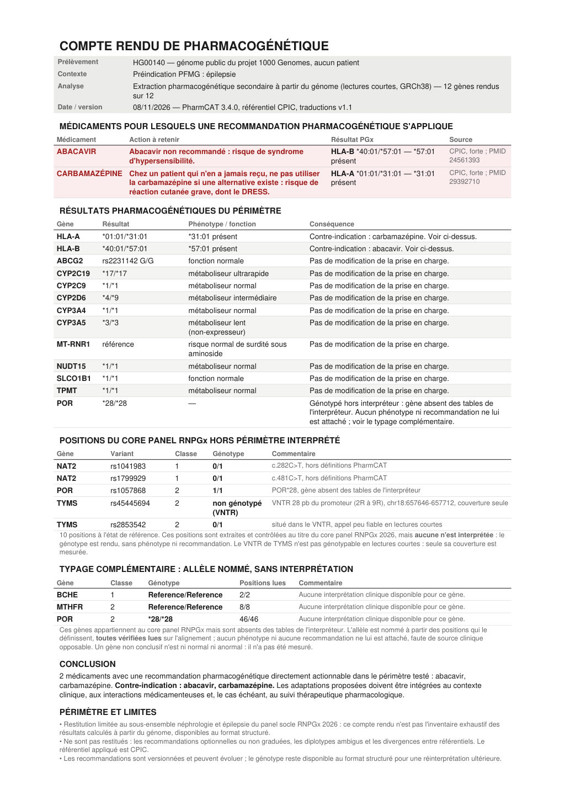
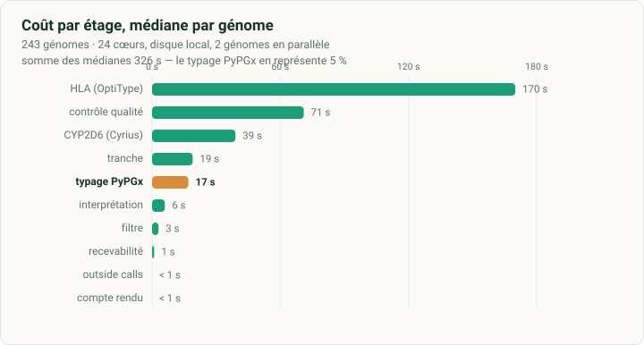

# Module pharmacogénétique pour génome entier — mode d'emploi

Ce module lit un génome déjà séquencé et déjà aligné par la plateforme, et rend
un avis pharmacogénétique sur treize gènes. Il ne demande ni nouveau prélèvement,
ni nouvelle course de séquençage, ni réalignement, ni second appel de variants.

Règle de conception : **aucun résultat faux ne doit pouvoir sortir sans être
signalé**. Chaque étage teste son code de retour, inscrit son état, et refuse de
se rabattre sur une entrée de secours. Le code de retour du module ne vaut zéro
que si les neuf étages requis ont abouti.

Les sections 1 à 4 suffisent pour installer et exploiter. Les suivantes
expliquent ce que fait le module et ce qu'il garantit. Le vocabulaire est défini
dans `doc/GLOSSAIRE.md`.

---

## 1. Mise en service

### 1.1 Ce qu'il faut sur la machine

| Outil | Rôle |
|---|---|
| `bash` 4 ou plus | l'orchestrateur |
| `docker`, ou `apptainer` / `singularity` par `PGX_MOTEUR` | les quatre conteneurs |
| `samtools` 1.13 ou plus | tranche, profondeur, extraction du complexe majeur |
| `python3` 3.8 ou plus, avec `reportlab` | contrôle qualité, trace, compte rendu |
| GNU `coreutils` et `findutils` | `stat -c`, `xargs -d` dans le traitement de lot |
| dépôt Cyrius, commit `7c060db`, avec ses dépendances Python | l'étage CYP2D6 |
| ressource de données PyPGx 0.27.0 (`PYPGX_BUNDLE`) | le typage PyPGx, s'il est activé |

La **référence GRCh38** indexée qui a servi à l'alignement ne se télécharge pas :
c'est celle de la plateforme, et elle doit être la même. Le reste s'installe.

```bash
git clone https://github.com/victormar1/pgx-genome.git
cd pgx-genome
git checkout "$(git describe --tags --abbrev=0)"   # la dernière release
pip install -r env/requirements.txt

git clone https://github.com/Illumina/Cyrius.git /opt/Cyrius
git -C /opt/Cyrius checkout 7c060db
pip install -r /opt/Cyrius/requirements.txt

git clone --branch 0.27.0 https://github.com/sbslee/pypgx-bundle.git /opt/pypgx-bundle
```

Les variables à exporter, une fois pour toutes :

```bash
export PGX_FASTA=/chemin/GRCh38_full_analysis_set_plus_decoy_hla.fa
export PGX_CYRIUS=/opt/Cyrius
export PGX_IMG_PYPGX=pgx-genome/pypgx:0.27.0   # absent : étage 4b ignoré
export PYPGX_BUNDLE=/opt/pypgx-bundle
```

### 1.2 Les quatre conteneurs

Versions figées, digests dans `env/conteneurs.txt`. Un changement de version
change les résultats et impose une revalidation (§ 10).

```bash
docker pull quay.io/biocontainers/bcftools:1.24--h118bc1c_2
docker pull quay.io/biocontainers/optitype:1.3.5--hdfd78af_3
docker pull pgkb/pharmcat:3.4.0
docker build -f env/pypgx.Dockerfile -t pgx-genome/pypgx:0.27.0 env
```

La quatrième se construit sur place : ses auteurs ne la distribuent pas en
conteneur. Sous Docker, les conteneurs tournent sous l'identité de l'appelant,
pour que les sorties lui appartiennent. Ils reçoivent son UID et son groupe
principal, pas ses groupes secondaires : les entrées doivent être lisibles par
l'un des deux.

Sous Apptainer, `PGX_IMG_*` nomme soit une image de dépôt, tirée à l'exécution,
ce qui demande le réseau sur chaque nœud, soit un fichier `.sif` local, dont
le hash est alors tracé ; un `.sif` absent est refusé au démarrage. Les
`.sif` se préparent une fois, **avec un dossier temporaire sur disque local** :
sur un disque monté en réseau, la conversion de l'image de l'interpréteur prend
des heures.

```bash
export APPTAINER_TMPDIR=/disque/local/tmp
apptainer build bcftools.sif docker://quay.io/biocontainers/bcftools:1.24--h118bc1c_2
apptainer build pharmcat.sif docker://pgkb/pharmcat:3.4.0
apptainer build optitype.sif docker://quay.io/biocontainers/optitype:1.3.5--hdfd78af_3
apptainer build pypgx.sif    docker-daemon://pgx-genome/pypgx:0.27.0

export PGX_MOTEUR=apptainer
export PGX_IMG_BCFTOOLS=$PWD/bcftools.sif PGX_IMG_PHARMCAT=$PWD/pharmcat.sif
export PGX_IMG_OPTITYPE=$PWD/optitype.sif PGX_IMG_PYPGX=$PWD/pypgx.sif
```

L'image PyPGx se construit avec Docker. Sur un site sans Docker, la construire
et la convertir sur une machine de préparation, puis copier le `.sif`.

### 1.3 Qualifier l'installation

Dans l'ordre, chaque étape ayant un résultat attendu.

| Étape | Commande | Attendu |
|---|---|---|
| 1. Installer | § 1.1 et 1.2 ci-dessus | `bin/pgx_genome.sh --version` rend la version |
| 2. Contrôler les trois images tirées | `docker image inspect --format '{{index .RepoDigests 0}}' <image>` | les digests de `env/conteneurs.txt` ; l'image PyPGx, construite sur place, n'en a pas |
| 3. Passer les contrôles du dépôt | `python3 -m unittest discover -s tests` puis `python3 outils/verifier_depot.py` | tous passent |
| 4. Rejouer le génome de qualification | voir ci-dessous | **0 écart** |
| 5. Confronter le variant caller de la plateforme | sur ses propres génomes | voir § 10 ; à faire avant tout usage clinique |

**Le génome de qualification.** `bench/qualification/` porte, pour un génome
public du 1000 Genomes, son fichier de variants et le rapport de référence que ce
module en produit. La plateforme télécharge l'alignement depuis le projet 1000
Genomes (adresse et MD5 dans `bench/qualification/LISEZMOI.md`), exécute le
module avec sa propre référence GRCh38, puis compare :

```bash
python3 outils/comparer_rapports.py --avant bench/qualification --apres /chemin/resultats
```

Le code de retour vaut zéro si diplotypes, phénotypes et recommandations sont
identiques. Tout écart désigne une différence d'installation — version d'image,
référence, typeur — à résoudre avant tout usage sur un patient. Une plateforme
sous Apptainer rejoue cette qualification sous ce moteur.

## 2. Ce qu'il faut lui donner

| Entrée | Format | Contrainte |
|---|---|---|
| Alignement | CRAM ou BAM indexé | GRCh38, le même que celui du rendu diagnostique |
| Variants | VCF d'un seul échantillon | GRCh38, avec `GT`, `GQ` et `AD` ; couvrant le génome entier, contig mitochondrial compris |
| Référence | FASTA indexé | celle qui a servi à l'alignement, obligatoire pour un CRAM |

Une région absente du fichier de variants rend ses gènes non conclusifs, jamais
« référence ».

Le module **refuse** à l'entrée, sans lancer aucun étage :

- un fichier de variants portant plus d'un échantillon ;
- un fichier de variants qui ne déclare pas `AD`, les lectures par allèle ;
- trois noms deux à deux différents : l'identifiant demandé, celui du fichier de
  variants et le champ `SM` de l'alignement. Une divergence entre les deux
  derniers est acceptée si la demande nomme l'un d'eux, et elle est tracée ;
- un alignement tronqué, c'est-à-dire dont le marqueur de fin manque ;
- un alignement dont les contigs visés sont absents, ou dont l'un d'eux n'a pas
  la longueur que lui donne la référence fournie ;
- un alignement sur lequel l'accès à une région ciblée échoue, faute d'index
  lisible.

Les deux dernières vérifications ne sont pas de confort. Un alignement sur un
autre assemblage ne lève aucune erreur : les régions visées n'y existent pas, la
tranche revient vide, et tout ce qui suit conclut à une absence de couverture. Le
contrôle ne nomme aucun assemblage, il confronte les contigs et leurs longueurs à
ceux de la référence passée en argument.

**Un refus arrête tout.** Aucun étage ne démarre, le dossier de travail est vidé
de ses intermédiaires, et la seule sortie est `provenance.json`, qui porte le
motif. La purge n'est pas une précaution de confort : avec `--reprise`, la tranche
d'une exécution antérieure serait retrouvée par l'étage 2a, qui se déclarerait
abouti, et le module rendrait un compte rendu pour un génome qu'il vient de
refuser.

**Le champ `GQ` n'est pas un confort.** Une position dont la qualité est absente
ou illisible est **écartée**, pas acceptée : le module préfère déclarer qu'il n'a
pas mesuré plutôt que de laisser passer une mesure qu'il ne peut pas juger. Sans
`GQ` nulle part, le périmètre se réduit aux positions identiques à la référence,
et le compte rendu le dit.

**Le champ `AD` non plus.** Sans lectures par allèle, ni l'équilibre allélique
d'un hétérozygote ni la part d'hétérozygotes déséquilibrés ne se mesurent : le
contrôle qualité les sauterait sans le dire. Un fichier de variants qui ne
déclare pas `AD` est refusé à l'entrée.

**Un gVCF est accepté**, ses blocs de référence ignorés : le module va chercher
la profondeur dans l'alignement, ce qui est une mesure directe plutôt qu'une
déclaration. Le résultat est le même qu'avec un VCF de variants.

## 3. Lancer

### 3.1 Un génome

Les variables de la section 1.1 étant exportées :

```bash
bin/pgx_genome.sh \
  --cram    /chemin/echantillon.cram \
  --vcf     /chemin/echantillon.vcf.gz \
  --sortie  /chemin/resultats/echantillon \
  --echantillon ECH001 \
  --identite /chemin/identite.json
```

Le fichier d'identité porte `patient`, `naissance` et `contexte` (la
préindication). Il passe par un chemin, jamais par des arguments : un argument
est lisible dans la table des processus et dans les journaux de l'ordonnanceur.
Sans identité, le document porte la mention « prototype ».

| Option | Défaut | Rôle |
|---|---|---|
| `--echantillon` | nom de l'alignement | identifiant du prélèvement, confronté au VCF et à l'alignement |
| `--fasta` | `$PGX_FASTA` | référence d'alignement |
| `--identite` | absente | JSON `{patient, naissance, contexte}` ; fourni, il lève la mention prototype |
| `--contexte` | absent | préindication portée sur le compte rendu, si le fichier d'identité n'en porte pas |
| `--gq` | 20 | seuil de qualité de génotype |
| `--profondeur` | 10 | seuil de profondeur par position |
| `--couverture-min` | 18 | couverture médiane sous laquelle le génome est refusé ; `0` désactive le critère |
| `--melange-max` | 35 | part d'hétérozygotes déséquilibrés au-delà de laquelle l'échantillon est refusé ; `0` désactive le critère |
| `--ignorer-filtre` | absente | retient les sites rejetés par l'appelant ; seulement si le VCF a été refiltré en amont |
| `--fils` | 4 | fils pour samtools, l'étage CYP2D6 et l'étage HLA |
| `--etage` | tous | ne fait tourner que les étages nommés, voir § 3.3 |
| `--reprise` | absente | réutilise les intermédiaires si les entrées sont identiques |
| `--forcer` | absente | écrit dans un dossier non vide sans purger |
| `--version` | — | version du module |

| Variable | Rôle |
|---|---|
| `PGX_FASTA`, `PGX_CYRIUS` | référence, dépôt Cyrius |
| `PGX_IMG_PYPGX`, `PYPGX_BUNDLE` | image de PyPGx et sa ressource ; `PGX_PYPGX` pour une installation de l'hôte |
| `PGX_MOTEUR` | `docker` (défaut), `apptainer` ou `singularity` |
| `PGX_IMG_BCFTOOLS`, `PGX_IMG_PHARMCAT`, `PGX_IMG_OPTITYPE` | images, à ne changer qu'avec une revalidation |
| `PGX_GQ`, `PGX_PROFONDEUR`, `PGX_COUVERTURE_MIN`, `PGX_MELANGE_MAX`, `PGX_IGNORER_FILTRE`, `PGX_FILS` | les options correspondantes |
| `PGX_PARALLELE` | parallélisme par défaut du traitement de lot |

### 3.2 Un lot

```bash
bin/pgx_lot.sh --manifeste liste.tsv --sortie /chemin/resultats --parallele 6
```

Le manifeste porte trois colonnes séparées par des tabulations : identifiant,
chemin de l'alignement, chemin du fichier de variants. Un échantillon déjà complet
est sauté. Le lot produit `tableau_de_bord.tsv` : une ligne par échantillon,
l'état et la durée de chaque étage. Le parallélisme vaut 4 par défaut et est
mesuré jusqu'à six : compter un génome pour quatre cœurs (§ 9).
Le lanceur ne transmet pas d'identité : ses comptes rendus portent la mention
prototype.

### 3.3 Un étage à la fois

`--etage` fait tourner les seuls étages nommés, séparés par des virgules. C'est
**le même code** que l'exécution complète : ce qui a été validé d'un seul tenant
est ce qui tourne étage par étage. Un ordonnanceur peut ainsi réserver à chaque
étage ce qu'il consomme (§ 9), et relancer un étage sans rejouer les autres.

| Ordre | Étages | À savoir |
|---|---|---|
| 1 | `recevabilite` | ouvre le dossier : seule à le purger et à remettre la trace à zéro |
| 2 | `filtre`, `tranche` | |
| 3 | `qc` | peut refuser le génome |
| 4 | `cyp2d6`, `hla`, `pypgx` | **indépendants, à lancer ensemble** |
| 5 | `appels`, `pharmcat`, `rendu`, `provenance` | |

Chaque étage retrouve ses prérequis dans le dossier de travail, et non dans la
mémoire d'un processus qu'il ne partage plus :

- un étage refuse (code 2) un dossier qui ne porte pas la recevabilité **de ces
  mêmes entrées et options** — sinon il travaillerait sur les intermédiaires d'un
  autre échantillon ;
- un refus, à l'entrée ou après le contrôle qualité, s'inscrit dans
  `travail/arret.txt`, et tout étage lancé ensuite refuse à son tour ;
- deux instances d'un même étage s'excluent (code 3), des étages différents
  tournent ensemble, et rien ne tourne pendant que la recevabilité purge.

Le code de retour d'un étage lancé seul ne dit que **ses** étages. L'étage
`provenance` rend le code de l'exécution complète. Un étage relancé après un échec
compte par sa dernière exécution, et la trace note le nombre de tentatives.

`exemples/pgx_genome.nf` en donne une recette Nextflow, un processus par étage,
qui déclare pour chacun les cœurs et la mémoire mesurés (§ 9). Elle reçoit le
moteur, les images et PyPGx en paramètres (`--moteur`,
`--img_*`, `--bundle`) ; son en-tête donne l'appel.

## 4. Ce qu'il rend, et ce qu'il faut surveiller

| Sortie | Contenu |
|---|---|
| `sortie/<ECH>.report.json` | l'avis complet, structuré, exploitable par une machine |
| `sortie/CR_<ECH>.pdf` | compte rendu en français, deux pages : médicaments, résultats par gène, positions complémentaires, typage complémentaire (PyPGx), conclusion, limites |
| `sortie/provenance.json` | hash des entrées, digests et versions des images, seuils, état de chaque étage |
| `travail/perimetre.json` | par gène : positions attendues, retenues, perdues, statut |
| `travail/qc_positions.tsv` | une ligne par position diagnostique, ce qui a été lu |
| `travail/etats.tsv` | l'état et la durée de chaque étage |

Un compte rendu complet, contexte épilepsie : les médicaments concernés en tête,
les treize gènes du périmètre, les positions du core panel rendues en génotype
sans interprétation, le typage complémentaire (PyPGx), puis la conclusion et les limites.

<p align="center"></p>

**Le champ à surveiller est `reussite_complete`**, dans `provenance.json`. Il vaut
`true` seulement si les neuf étages requis sont présents et qu'aucun étage,
l'optionnel compris, n'est en échec. Un dictionnaire d'étages vide donne `false`.

Un étage peut porter l'état **sans résultat** : il a tourné jusqu'au bout et n'a
rien conclu. Ce n'est pas une défaillance du module, le gène concerné est rendu
non analysé, et `etages_sans_resultat` les nomme. Confondre les deux ferait passer
pour une panne ce qui est une limite de l'outil sur ce génome, et inversement.

**Codes de retour.** Ce qu'un ordonnanceur doit savoir pour décider, sans lire le
journal.

| Code | Signification | Conduite |
|---|---|---|
| `0` | les neuf étages requis ont abouti | le compte rendu est exploitable |
| `1` | au moins un étage en échec ; les sorties produites existent | à instruire, gène par gène, par `provenance.json` |
| `2` | génome refusé — à l'entrée, ou après le contrôle qualité pour couverture insuffisante ou mélange —, ou configuration invalide : option inconnue, moteur ou image absents, ressource du typeur absente ; **aucun compte rendu** | le motif est sur la sortie d'erreur, dans le journal et la trace ; relancer à l'identique ne sert à rien |
| `3` | une autre exécution travaille dans le même dossier de sortie | réessayer plus tard, ou choisir un autre dossier |

Le verrou qui produit le code `3` est pris par `mkdir`, qui est atomique, et porte
le processus et l'hôte qui le tiennent. Si son détenteur est mort sur le même
hôte, le verrou est repris : une tâche tuée par l'ordonnanceur ne bloque pas le
dossier. Un verrou posé depuis **un autre hôte** n'est jamais repris, un numéro de
processus n'y voulant rien dire ; après une panne de nœud, l'exploitant retire les
dossiers `.verrou*` du dossier de sortie.

**Traçabilité.** Le hash enregistré pour l'alignement porte sur ses 512
premiers mégaoctets : lire trente gigaoctets pour tracer une exécution coûterait
plus cher que l'analyse. Ceux du fichier de variants et des ressources portent
sur la totalité ; celui de la référence, sur ses 64 premiers mégaoctets,
complété par celui de son index `.fai`, qui décrit tous ses contigs. Les
conteneurs sont tracés par leur digest, pas par leur tag.

## 5. Les deux refus mesurés

**Un génome trop peu couvert est refusé.** Le contrôle qualité mesure la
couverture médiane des positions du périmètre clinique sur l'alignement. Sous
`--couverture-min`, le module s'arrête au sortir de l'étage 2b : code de sortie 2,
aucun compte rendu, motif dans le journal, la table d'états et la trace.

Ce n'est pas un avertissement, parce qu'un avertissement ne protège de rien : sous
le seuil, un allèle variant peut être lu comme référence, et l'interpréteur rend
alors un diplotype faux sans réserve — jusqu'à doubler une dose de tacrolimus. Le
domaine a été mesuré sur 36 exécutions (`doc/VALIDATION.md` § 3.4). Pour traiter
sciemment un génome hors domaine, `--couverture-min 0` ; la couverture mesurée
reste inscrite sur le compte rendu.

**Un échantillon mélangé est refusé.** Le contrôle qualité mesure la part des
hétérozygotes appelés dont l'allèle mineur est soutenu par moins de 30 % des
lectures. Au-delà de `--melange-max`, le module s'arrête de la même façon.

**Ce critère arrête un mélange grossier et ne détecte pas un mélange de 20 %**,
qui modifie pourtant le document rendu : l'information n'existe pas sur les
positions que le module lit. Un contrôle de contamination sur le génome entier
reste nécessaire en amont (`doc/VALIDATION.md` § 3.7 et limite 4.6).

## 6. Les étages

Neuf étages requis, plus un optionnel, le typage PyPGx (4b), activé par
`PGX_IMG_PYPGX` ou `PGX_PYPGX`. Non activé, il est ignoré et ne pèse pas sur
`reussite_complete` ; activé, son échec compte comme celui d'un autre étage.

**0. Recevabilité.** Les six contrôles de la section 2. Aucun étage ne démarre si
l'un d'eux échoue.

**1. Filtre.** Restreint le fichier de variants aux régions qui portent les 1 226
positions interrogées. Ces régions font 42 kb au total, en 258 intervalles, parce
que chaque position est élargie de cinquante bases de part et d'autre pour que les
insertions et délétions décalées soient récupérées. Le fichier réduit porte donc
quelques enregistrements hors cible ; l'étage suivant ne retient que les 1 226
positions nommées.

**2a. Tranche.** Extrait de l'alignement les régions utiles : les mêmes 42 kb, le
complexe majeur d'histocompatibilité, et les contigs HLA alternatifs de la
référence, qui sont lus dans l'en-tête de l'alignement et non figés dans le
module. Une seule traversée du fichier. Tout ce qui suit travaille sur cette
tranche.

**2b. Contrôle qualité.** Confronte le fichier réduit et la tranche, position par
position. Produit le périmètre : la liste des gènes dont toutes les positions
diagnostiques ont été lues à une profondeur et une qualité suffisantes. Écarte les
génotypes qui ne tiennent pas le seuil en les ramenant à « non appelé », jamais à
« référence ». Échoue si la profondeur n'a pas pu être mesurée sur l'alignement,
si le fichier porte plus d'un échantillon, ou si un enregistrement se perd à la
réécriture.

Cinq motifs écartent une position, tous mesurés sur génomes réels avant d'être
retenus : qualité de génotype sous le seuil, profondeur sous le seuil, **site
rejeté par le filtrage de l'appelant**, **génotype calculé sur moins de lectures
que le seuil de profondeur** même si l'alignement en porte davantage, et
**déséquilibre allélique**, quand un allèle d'un hétérozygote porte moins du quart
des lectures. Ce dernier motif ne s'applique pas aux gènes dont le nombre de
copies varie, où une duplication déplace légitimement l'équilibre : seul CYP2D6
est dans ce cas, et son diplotype vient d'un outil dédié. Le filtrage de
l'appelant peut être ignoré par `--ignorer-filtre`, à n'utiliser que si le fichier
de variants a déjà été refiltré en amont.

Le contrôle marque aussi chaque gène comme appartenant ou non au **périmètre
clinique**, les treize gènes du sous-ensemble RNPGx : cette distinction commande
ce que le compte rendu rapporte. Il mesure enfin les deux conditions d'emploi qui
peuvent refuser le génome (§ 5).

**Complément RNPGx.** Les 18 positions de classe 1 et 2 du core panel absentes des
définitions de l'interpréteur sont mesurées au même titre (profondeur, qualité,
filtre), mais suivies à part dans `perimetre.json` → `complement_rnpgx`. Elles
n'entrent pas dans le statut d'un gène et ne sont jamais masquées dans le VCF de
l'interpréteur. Un VNTR n'est pas génotypé : seule sa couverture est mesurée.

**3. CYP2D6.** Ce gène ne se lit pas dans un fichier de variants : il porte des
duplications, des délétions et des hybrides avec son pseudogène voisin. Un outil
dédié lit l'alignement complet et rend un diplotype. L'étage échoue si l'outil
échoue. S'il tourne jusqu'au bout sans conclure, l'étage porte l'état **sans
résultat**, qui n'est pas un échec : le gène est rendu non analysé, et le module
reste en réussite complète.

Deux situations donnent ce résultat. L'outil peut ne rendre aucun diplotype, sur
un locus trop remanié : sur ce benchmark, un génome porte onze copies du locus avec
sept hybrides en série. Il peut aussi rendre plusieurs lectures possibles, qu'il
sépare par un point-virgule. Elles ne sont **pas** transmises à l'interpréteur. En
choisir une serait affirmer ce que l'outil n'a pas dit, et les phénotypes diffèrent
d'une lecture à l'autre ; l'interpréteur refuse d'ailleurs une telle ligne et
s'arrête, ce qui ferait perdre tout le génome.

**4. HLA.** Même situation. Les lectures du complexe majeur sont extraites de la
tranche et typées séparément. L'étage échoue en dessous de deux cents paires.

**4b. Typage PyPGx (optionnel).** MT-RNR1, BCHE, MTHFR et POR sont typés
par PyPGx, qui lit la région entière du gène : l'étage lui prépare une extraction
distincte, sans toucher au fichier qualifié. Sur une région non couverte, le typeur
rend « Reference » sans lever d'erreur ; un gène n'est donc rendu que si toutes ses
positions définissantes sont lues au-dessus du seuil **et** qualifiées selon le
critère de l'étage 2b, sinon non conclusif. Le génotype est reconstruit depuis les
deux haplotypes, non depuis le diplotype du typeur, qui n'en garde qu'un allèle par
haplotype. Un typeur qui ne s'exécute pas fait échouer l'étage : c'est une panne
d'installation, pas une limite de la donnée.

Le typeur tourne dans une image construite sur place (`env/pypgx.Dockerfile`),
lancée par le moteur de conteneurs comme les trois autres : ses auteurs ne le
distribuent pas en conteneur, et une installation Python à maintenir sur chaque
nœud n'est pas acceptable sur une plateforme. Sa ressource de données
(`PYPGX_BUNDLE`, plusieurs gigaoctets, même version que le typeur) reste montée et
n'est pas copiée dans l'image.

**5. Outside calls.** Met les résultats précédents au format attendu par
l'interpréteur. Les tandems de CYP2D6 sont écrits avec des espaces autour du plus,
faute de quoi l'interpréteur rend un résultat indéterminé sans lever d'erreur.
MT-RNR1 est haploïde : un allèle seul, pas une paire. L'étage échoue si un étage
marqué `OK` n'a pas déposé sa ligne.

**6. Interprétation.** L'interpréteur reçoit le fichier qualifié et les appels
externes. **Aucun repli** : si le fichier qualifié est absent, l'étage échoue. Se
rabattre sur le fichier filtré remettrait en service les génotypes écartés sur leur
qualité, et la garantie du module disparaîtrait sans une ligne de trace.

**7. Compte rendu.** Structuré selon le cahier des charges PFMG : médicaments
concernés d'abord, puis résultats par gène, conclusion, périmètre et limites.
Seules les recommandations CPIC fortes ou modérées qui modifient la prise en
charge sont restituées ; un diplotype ambigu n'en déclenche aucune. Les consignes
sont traduites par `ressources/traductions_cpic_fr.json` ; un texte inconnu de la
table sort en anglais et est signalé, plutôt que d'être tu. Le périmètre de
l'étage 2b commande ce que le document a le droit d'écrire.

Les étages 3 et 4 ne dépendent pas de l'étage 2b.

## 7. Les garde-fous, et pourquoi ils existent

**Le périmètre se déduit des données, jamais d'une liste écrite à la main.** Avec
une liste tenue à la main, un gène absent du fichier de variants passe au travers :
il ressort de type référence, avec la mention « appelé ». Mesuré sur ce benchmark,
quatre faux négatifs sur six pour un seul gène, sans aucun avertissement.

**L'option de remplissage par la référence est limitée aux positions absentes.**
L'interpréteur propose de considérer comme identiques à la référence à la fois les
positions absentes du fichier et les génotypes explicitement non appelés. La
seconde moitié annulerait le contrôle qualité.

**Les génotypes sont filtrés sur leur qualité avant interprétation.** Une position
d'un transporteur hépatique a une qualité médiane de 6 sur soixante-treize génomes,
quand les trente-quatre autres positions du même gène sont au-dessus de 81. Elle se
trouve dans une zone où les lectures se placent mal, et elle passe pourtant les
filtres de cohorte.

**Une qualité absente écarte la position.** Un seuil qu'on ne peut pas appliquer
n'est pas un seuil satisfait.

**Aucun fichier intermédiaire n'est choisi par ordre alphabétique.** Les noms
attendus sont construits, jamais devinés par un motif. Un reste d'exécution
antérieure ne peut pas être repris à la place du fichier courant.

**Les intermédiaires sont liés à un hash des entrées.** Sans `--reprise`, le
dossier de travail est purgé. Avec `--reprise`, les intermédiaires ne sont
réutilisés que si l'alignement, le fichier de variants, la référence, les
ressources et les seuils sont identiques.

**Une recommandation forte non traduite sort en texte source, jamais omise**, et
les médicaments concernés sont nommés en bas du compte rendu. Écarter ce qu'on ne
sait pas traduire ferait disparaître, sur un métaboliseur lent de ce benchmark, quatre
recommandations sur neuf, dont deux contre-indications d'antalgiques.

**Un diplotype long n'est jamais résumé par une affirmation de contenu.** Il est
dit ambigu, ou coupé. Écrire « génotype de référence » sur un diplotype variant
inverserait le sens du compte rendu.

**La mention « prototype » tombe avec l'identité, sans option à ajouter.** Une
option oubliée par la plateforme ferait sortir un compte rendu de patient qui se
déclare sans patient.

## 8. Le périmètre clinique

Le produit revendique **treize gènes**, le sous-ensemble néphrologie et épilepsie
du panel socle du RNPGx 2026, décrit dans `ressources/perimetre_rnpgx.json` :
CYP2C9, HLA-A et HLA-B pour l'épilepsie ; CYP3A5, CYP3A4, POR, CYP2C19, CYP2D6,
SLCO1B1, ABCG2, TPMT et NUDT15 pour la néphrologie et la transplantation ; MT-RNR1
pour les aminosides.

Le compte rendu ne rapporte que ces gènes. L'interpréteur en analyse vingt-deux :
les dix autres, mesurés au passage, sont **nommés mais non rapportés**, sous le
titre « Hors périmètre ». Leur validation clinique n'a pas été conduite.

Trois réserves sur le périmètre lui-même. **POR** n'a pas de table dans
l'interpréteur : le typage PyPGx le rend en allèle nommé, sans phénotype
ni recommandation. **ABCG2** n'a aucun échantillon dans la table du CDC : sa
position décisive est confrontée à une puce de génotypage, 228 génomes sur 228
concordants. **NUDT15** n'y a que six échantillons, ce qui prouve peu sur
l'azathioprine. Ce que le benchmark établit, gène par gène, est dans `doc/VALIDATION.md`
§ 3.1 et limite 4.2.

**Ce que le module ne fait pas :**

- **MT-RNR1** n'est pas appelable par l'interpréteur, qui ne déclare aucune
  position pour ce gène : sans l'étage 4b, il est rendu non analysé.
- **Les remaniements de structure** ne sont analysés que pour CYP2D6.
- **Seuls les allèles répertoriés** au catalogue de référence sont recherchés. Un
  variant délétère non répertorié donne un résultat de métaboliseur normal.
- **La profondeur est comptée sans filtre de qualité d'alignement.** Une position
  couverte uniquement par des lectures mal placées est comptée comme lue, à moins
  que la profondeur de l'appelant, elle, ne tombe sous le seuil.
- **Le module ne valide pas biologiquement.** Il prépare, il ne signe pas.

## 9. Coût mesuré

Machine de mesure : vingt-quatre cœurs, soixante-deux gigaoctets de mémoire, disque dur
monté sous WSL2. Un génome prend 270 secondes et coûte 351 secondes de
processeur, soit **1,3 cœur en moyenne**. Il laisse 364 Mo sur disque en médiane
et 477 au plus sur dix, dont trois quarts de lectures du complexe HLA.

<p align="center"></p>

Le typage HLA est l'étage long, devant le contrôle qualité et CYP2D6. À froid, la
tranche et CYP2D6 s'allongent : ce sont les deux qui lisent l'alignement, CYP2D6
en trois mille régions dispersées.

**Ce qu'un ordonnanceur doit réserver.** Chaque étage lancé seul, la machine ne
faisant rien d'autre : les cœurs sur trois génomes déjà lus, la mémoire sur trois
autres, dont le pire cas du lot — le plus de lectures HLA et la plus forte
couverture.

| Étage | Durée | Cœurs, moyenne | Cœurs, pointe | Mémoire, pointe |
|---|---|---|---|---|
| 0 · recevabilité | 1 s | 1,4 | 2,7 | 160 Mo |
| 1 · filtre | 3 s | 1,8 | 2,3 | 80 Mo |
| 2a · tranche | 15 s | 1,1 | 3,4 | 940 Mo |
| 2b · contrôle qualité | 65 s | 1,0 | 2,0 | 120 Mo |
| 3 · CYP2D6 | 17 s | 1,9 | 3,8 | 650 Mo |
| 4 · HLA | 145 s | 1,1 | 4,4 | 1,9 Go |
| 4b · typage PyPGx | 14 s | 3,7 | 10,9 | 670 Mo |
| 6 · interprétation | 5 s | 2,0 | 3,8 | 1,6 Go |
| appels, compte rendu, trace | 4 s | 1,5 | 4,1 | 120 Mo |

La recette Nextflow déclare ces valeurs, étage par étage. L'interprétation tourne
sur Java, qui prend 1,6 Go parce qu'il le peut : sous une limite de 1 Go, elle
rend le même avis.

**Combien de génomes de front.** Le module est presque séquentiel : le débit
d'une machine ne tient qu'à ce nombre. Compter **un génome pour quatre cœurs**.
Six de front sur vingt-quatre cœurs rendent 51 génomes par heure par la recette,
39 par le lanceur de lot, sur des alignements lus à froid. Au-delà de six, rien
n'est mesuré ; à froid, c'est le disque qui borne et non le processeur
(`doc/VALIDATION.md` § 3.10).

## 10. Régler les seuils, et quand tout remesurer

**Les deux seuils sont des choix, pas des constantes.** Avant d'en hériter, une
plateforme peut rejouer le contrôle qualité à d'autres valeurs sur ses propres
résultats, sans relire un seul alignement :

```bash
python3 bin/sensibilite_seuils.py --lot /chemin/resultats --sortie /chemin/analyse
```

Le script relit les `qc_positions.tsv` du lot et recompte, pour chaque couple de
seuils, combien de gènes sortent complets, sous réserve ou sans résultat. Il nomme
aussi les positions dont la qualité est juste au-dessus du seuil : ce sont elles
qui basculent en premier.

Mesuré sur cent cinq génomes de ce benchmark, la profondeur pèse environ huit fois plus
que la qualité de génotype. Passer la profondeur de dix à vingt coûte treize points
de gènes complets, quand passer la qualité de vingt à trente n'en coûte qu'un et
demi. Le seuil de qualité par défaut n'est donc pas au bord d'une falaise, celui de
profondeur en est proche.

**Ce qui impose une revalidation** : une version d'image, une table clinique, une
ressource, un seuil par défaut, ou le changement de variant caller en amont.
La procédure, les déclencheurs et l'outillage qui refait le benchmark sont dans
`doc/VALIDATION.md` § 5 et `bench/LISEZMOI.md`.
