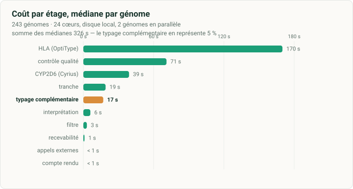

# Module pharmacogénétique pour génome entier

Ce module lit un génome déjà séquencé et déjà aligné par la plateforme, et rend
un avis pharmacogénétique. Il ne demande ni nouveau prélèvement, ni nouvelle
course de séquençage, ni réalignement, ni second appel de variants.

Règle de conception : **aucun résultat faux ne doit pouvoir sortir sans être
signalé**. Chaque étage teste son code de retour, inscrit son état, et refuse de
se rabattre sur une entrée de secours. Le code de retour du module ne vaut zéro
que si les neuf étages requis ont abouti.

---

## 1. Ce qu'il faut lui donner

| Entrée | Format | Contrainte |
|---|---|---|
| Alignement | CRAM ou BAM indexé | GRCh38, le même que celui du rendu diagnostique |
| Variants | VCF d'un seul échantillon | GRCh38, avec les champs `GT`, `GQ` et `DP` ; couvrant le génome entier, contig mitochondrial compris — une région absente du fichier rend ses gènes non conclusifs, jamais « référence » |
| Référence | FASTA indexé | celle qui a servi à l'alignement, obligatoire pour un CRAM |

Le module **refuse** à l'entrée, sans lancer aucun étage :

- un fichier de variants portant plus d'un échantillon ;
- un identifiant demandé qui ne concorde ni avec le nom porté par le fichier de
  variants, ni avec le champ `SM` de l'alignement ;
- un alignement tronqué, c'est-à-dire dont le marqueur de fin manque ;
- un alignement dont les contigs visés sont absents, ou dont l'un d'eux n'a pas
  la longueur que lui donne la référence fournie ;
- un alignement sur lequel l'accès à une région ciblée échoue, faute d'index
  lisible.

Les deux dernières vérifications ne sont pas de confort. Un alignement sur un
autre assemblage ne lève aucune erreur : les régions visées n'y existent pas, la
tranche revient vide, et tout ce qui suit conclut à une absence de couverture.
Le contrôle ne nomme aucun assemblage, il confronte les contigs et leurs
longueurs à ceux de la référence passée en argument.

**Un refus arrête tout.** Aucun étage ne démarre, le dossier de travail est
vidé de ses intermédiaires, et la seule sortie est `provenance.json`, qui porte
le motif. La purge n'est pas une précaution de confort : avec `--reprise`, la
tranche d'une exécution antérieure serait retrouvée par l'étage 2a, qui se
déclarerait abouti, et le module rendrait un compte rendu pour un génome qu'il
vient de refuser.

La présence de `GQ` n'est pas un confort. Une position dont la qualité est
absente ou illisible est **écartée**, pas acceptée : le module préfère déclarer
qu'il n'a pas mesuré plutôt que de laisser passer une mesure qu'il ne peut pas
juger. Sans `GQ` nulle part, le périmètre se réduit aux positions identiques à la
référence, et le compte rendu le dit.

**Sur les blocs de référence d'un gVCF.** Le module ne les lit pas. Il n'en a pas
besoin : il va chercher la profondeur dans l'alignement, ce qui est une mesure
directe plutôt qu'une déclaration. Un gVCF est donc accepté, ses blocs sont
ignorés, et le résultat est le même qu'avec un VCF de variants.

## 2. Ce qu'il rend

| Sortie | Contenu |
|---|---|
| `sortie/<ECH>.report.json` | l'avis complet, structuré, exploitable par une machine |
| `sortie/CR_<ECH>.pdf` | compte rendu en français, deux pages : médicaments, résultats par gène, positions complémentaires, typage complémentaire, conclusion, limites |
| `sortie/provenance.json` | entrées, empreintes, versions d'images, seuils, état de chaque étage |
| `travail/perimetre.json` | par gène : positions attendues, retenues, perdues, statut |
| `travail/qc_positions.tsv` | une ligne par position diagnostique, ce qui a été lu |
| `travail/etats.tsv` | l'état et la durée de chaque étage |

`provenance.json` porte le champ `reussite_complete`. Il vaut `true` seulement si
les neuf étages requis sont présents et qu'aucun étage, l'optionnel compris, n'est
en échec. Un dictionnaire d'étages vide donne `false`. C'est ce champ qu'une
plateforme surveille.

Un étage peut porter l'état **sans résultat** : il a tourné jusqu'au bout et n'a
rien conclu. Ce n'est pas une défaillance du module, le gène concerné est rendu
non analysé, et `etages_sans_resultat` les nomme. Confondre les deux ferait
passer pour une panne ce qui est une limite de l'outil sur ce génome, et
inversement.

L'empreinte enregistrée pour l'alignement porte sur ses **512 premiers
mégaoctets**, pas sur la totalité : lire trente gigaoctets pour tracer une
exécution coûterait plus cher que l'analyse elle-même. Celle du fichier de
variants et celle des ressources portent sur la totalité. Les conteneurs sont
tracés par leur empreinte immuable, pas par leur étiquette.

## 2 bis. Le contrat d'exécution

Ce qu'un ordonnanceur doit savoir pour décider, sans lire le journal.

| Code | Signification | Conduite |
|---|---|---|
| `0` | les neuf étages requis ont abouti | le compte rendu est exploitable |
| `1` | au moins un étage en échec ; les sorties produites existent | à instruire, gène par gène, par `provenance.json` |
| `2` | génome refusé — à l'entrée, ou après le contrôle qualité pour couverture insuffisante ou mélange —, ou configuration invalide : option inconnue, moteur de conteneurs absent, ressource du typeur absente ; **aucun compte rendu** | le motif est sur la sortie d'erreur, dans le journal et la trace ; relancer à l'identique ne sert à rien |
| `3` | une autre exécution travaille dans le même dossier de sortie | réessayer plus tard, ou choisir un autre dossier |

Le verrou qui produit le code `3` est pris par `mkdir`, qui est atomique, et
porte le processus et l'hôte qui le tiennent. Si son détenteur est mort sur le
même hôte, le verrou est repris : une tâche tuée par l'ordonnanceur ne bloque
pas le dossier. Un verrou posé depuis **un autre hôte** n'est jamais repris, un
numéro de processus n'y voulant rien dire ; après une panne de nœud, l'exploitant
retire les dossiers `.verrou*` du dossier de sortie.

## 2 ter. Un étage à la fois

`--etage` fait tourner les seuls étages nommés, séparés par des virgules. C'est
**le même code** que l'exécution complète : ce qui a été validé d'un seul tenant
est ce qui tourne étage par étage. Un ordonnanceur peut ainsi réserver à chaque
étage ce qu'il consomme (§ 10), et relancer un étage sans rejouer les autres.

| Ordre | Étages | |
|---|---|---|
| 1 | `recevabilite` | ouvre le dossier : seule à le purger et à remettre la trace à zéro |
| 2 | `filtre`, `tranche` | |
| 3 | `qc` | peut refuser le génome |
| 4 | `cyp2d6`, `hla`, `pypgx` | **indépendants, à lancer ensemble** |
| 5 | `appels`, `pharmcat`, `rendu`, `provenance` | |

Chaque étage retrouve ses prérequis dans le dossier de travail, et non dans la
mémoire d'un processus qu'il ne partage plus :

- un étage refuse (code 2) un dossier qui ne porte pas la recevabilité **de ces
  mêmes entrées et options** — sinon il travaillerait sur les intermédiaires d'un
  autre échantillon ;
- un refus, à l'entrée ou après le contrôle qualité, s'inscrit dans
  `travail/arret.txt`, et tout étage lancé ensuite refuse à son tour ;
- deux instances d'un même étage s'excluent (code 3), des étages différents
  tournent ensemble, et rien ne tourne pendant que la recevabilité purge.

Le code de retour d'un étage lancé seul ne dit que **ses** étages : `0` abouti,
sans résultat ou ignoré ; `1` en échec, l'échec est inscrit et la chaîne peut
continuer ; `2` refusé ; `3` déjà en cours. `provenance` rend le code de
l'exécution complète. Un étage relancé après un échec compte par sa dernière
exécution, et la trace note le nombre de tentatives.

`exemples/pgx_genome.nf` en donne une recette Nextflow, un processus par étage,
qui déclare pour chacun les cœurs et la mémoire mesurés (§ 10).

## 3. Les étages

Neuf étages requis, plus un optionnel, le typage complémentaire (4b), armé par
`PGX_IMG_PYPGX` ou `PGX_PYPGX`. Non armé, il est ignoré et ne pèse pas sur
`reussite_complete` ; armé, son échec compte comme celui d'un autre étage.

**0. Recevabilité.** Les cinq contrôles de la section 1. Aucun étage ne démarre
si l'un d'eux échoue.

**1. Filtre.** Restreint le fichier de variants aux régions qui portent les 1 226
positions interrogées. Ces régions font 42 kb au total, en 258 intervalles, parce
que chaque position est élargie de cinquante bases de part et d'autre pour que
les insertions et délétions décalées soient récupérées. Le fichier réduit porte
donc quelques enregistrements hors cible ; l'étage suivant ne retient que les
1 226 positions nommées.

**2a. Tranche.** Extrait de l'alignement les régions utiles : les mêmes 42 kb, le
complexe majeur d'histocompatibilité, et les contigs HLA alternatifs de la
référence, qui sont lus dans l'en-tête de l'alignement et non figés dans le
module. Une seule traversée du fichier. Tout ce qui suit travaille sur cette
tranche.

**2b. Contrôle qualité.** Confronte le fichier réduit et la tranche, position par
position. Produit le périmètre : la liste des gènes dont toutes les positions
diagnostiques ont été lues à une profondeur et une qualité suffisantes. Écarte
les génotypes qui ne tiennent pas le seuil en les ramenant à « non appelé »,
jamais à « référence ». Échoue si la profondeur n'a pas pu être mesurée sur
l'alignement, si le fichier porte plus d'un échantillon, ou si un enregistrement
se perd à la réécriture.

Cinq motifs écartent une position, tous mesurés sur génomes réels avant d'être
retenus : qualité de génotype sous le seuil, profondeur sous le seuil, **site
rejeté par le filtrage de l'appelant**, **génotype calculé sur moins de lectures
que le seuil de profondeur** même si l'alignement en porte davantage, et
**déséquilibre allélique**, quand un allèle d'un hétérozygote porte moins du
quart des lectures. Ce dernier motif ne s'applique pas aux gènes dont le nombre
de copies varie, où une duplication déplace légitimement l'équilibre : seul
CYP2D6 est dans ce cas, et son diplotype vient d'un outil dédié. Le filtrage de
l'appelant peut être ignoré par `--ignorer-filtre`, à n'utiliser que si le
fichier de variants a déjà été refiltré en amont.

Le contrôle marque aussi chaque gène comme appartenant ou non au **périmètre
clinique**, les treize gènes du sous-ensemble RNPGx. Cette distinction commande ce
que le compte rendu rapporte. Il mesure enfin deux conditions d'emploi qui
peuvent refuser le génome : la couverture médiane du périmètre (§ 8 bis) et la
part d'hétérozygotes déséquilibrés (§ 8 ter).

**2b bis. Complément RNPGx.** Les 18 positions de classe 1 et 2 du core panel
absentes des définitions PharmCAT sont mesurées au même titre (profondeur,
qualité, filtre), mais suivies à part dans `perimetre.json` → `complement_rnpgx`.
Elles n'entrent pas dans le statut d'un gène et ne sont jamais masquées dans le
VCF de l'interpréteur. Un VNTR n'est pas génotypé : seule sa couverture est
mesurée.

**3. CYP2D6.** Ce gène ne se lit pas dans un fichier de variants : il porte des
duplications, des délétions et des hybrides avec son pseudogène voisin. Un outil
dédié lit l'alignement complet et rend un diplotype. L'étage échoue si l'outil
échoue. S'il tourne jusqu'au bout sans conclure, l'étage porte l'état **sans
résultat**, qui n'est pas un échec : le gène est rendu non analysé dans le compte
rendu, et le module reste en réussite complète.

Deux situations donnent ce résultat. L'outil peut ne rendre aucun diplotype, sur
un locus trop remanié : sur ce banc, un génome porte onze copies du locus avec
sept hybrides en série. Il peut aussi rendre plusieurs lectures possibles, qu'il
sépare par un point-virgule. Elles ne sont **pas** transmises à l'interpréteur.
En choisir une serait affirmer ce que l'outil n'a pas dit, et les phénotypes
diffèrent d'une lecture à l'autre. L'interpréteur refuse d'ailleurs une telle
ligne et s'arrête, ce qui ferait perdre tout le génome.

**4. HLA.** Même situation. Les lectures du complexe majeur sont extraites de la
tranche et typées séparément. L'étage échoue en dessous de deux cents paires.

**4b. Typage complémentaire (optionnel).** MT-RNR1, BCHE, MTHFR et POR sont typés
par PyPGx, qui lit la région entière du gène : l'étage lui prépare une extraction
distincte, sans toucher au fichier qualifié. Sur une région non couverte le typeur
rend « Reference » sans lever d'erreur ; un gène n'est donc rendu que si toutes
ses positions définissantes sont lues au-dessus du seuil **et** qualifiées selon
le critère de l'étage 2b, sinon non conclusif. Le génotype est reconstruit depuis
les deux haplotypes, non depuis le diplotype du typeur, qui n'en garde qu'un
allèle par haplotype.

Le typeur tourne dans une image construite sur place (`env/pypgx.Dockerfile`),
lancée par le moteur de conteneurs comme les trois autres : ses auteurs ne le
distribuent pas en conteneur, et une installation Python à maintenir sur chaque
nœud n'est pas acceptable sur une plateforme. Sa ressource de données
(`PYPGX_BUNDLE`, plusieurs gigaoctets, même version que le typeur) reste montée,
et non copiée dans l'image. Une installation de l'hôte reste possible par
`PGX_PYPGX`.

**5. Appels externes.** Met les résultats précédents au format attendu par
l'interpréteur. Les tandems de CYP2D6 sont écrits avec des espaces autour du
plus, faute de quoi l'interpréteur rend un résultat indéterminé sans lever
d'erreur. MT-RNR1 est haploïde : un allèle seul, pas une paire. L'étage échoue
si un étage marqué `OK` n'a pas déposé sa ligne.

**6. Interprétation.** L'interpréteur reçoit le fichier qualifié et les appels
externes. **Aucun repli** : si le fichier qualifié est absent, l'étage échoue.
Se rabattre sur le fichier filtré remettrait en service les génotypes écartés sur
leur qualité, et la garantie du module disparaîtrait sans une ligne de trace.

**7. Compte rendu.** Structuré selon le cahier des charges PFMG : médicaments
concernés d'abord, puis résultats par gène, conclusion, périmètre et limites. Seules
les recommandations CPIC fortes ou modérées qui modifient la prise en charge sont
restituées ; un diplotype ambigu n'en déclenche aucune. Les textes CPIC sont traduits
par `ressources/traductions_cpic_fr.json` (correspondance exacte ; un texte inconnu
est rendu tel quel et signalé). L'identité du patient et la préindication viennent
du fichier `--identite` ; sans identité, le document porte la mention
« prototype » et se déclare sans patient. Le périmètre de l'étage 2b commande ce
qu'il a le droit d'écrire.

Les étages 3 et 4 ne dépendent pas de l'étage 2b.

## 4. Les garde-fous, et pourquoi ils existent

**Le périmètre se déduit des données, jamais d'une liste écrite à la main.**
Une version antérieure du banc excluait du compte rendu une liste de gènes tenue
à la main. Un gène absent du fichier de variants passait au travers et ressortait
de type référence, avec la mention « appelé » : quatre faux négatifs sur six pour
un seul gène, sans le moindre avertissement.

**L'option de remplissage par la référence est limitée aux positions absentes.**
L'interpréteur propose de considérer comme identiques à la référence à la fois
les positions absentes du fichier et les génotypes explicitement non appelés. La
seconde moitié annulerait le contrôle qualité.

**Les génotypes sont filtrés sur leur qualité avant interprétation.**
Une position d'un transporteur hépatique a une qualité médiane de 6 sur
soixante-treize génomes, quand les trente-quatre autres positions du même gène
sont au-dessus de 81. Elle se trouve dans une zone où les lectures se placent
mal, et elle passe pourtant les filtres de cohorte.

**Une qualité absente écarte la position.** Un seuil qu'on ne peut pas appliquer
n'est pas un seuil satisfait.

**Aucun fichier intermédiaire n'est choisi par ordre alphabétique.** Les noms
attendus sont construits, jamais devinés par un motif. Un reste d'exécution
antérieure ne peut pas être repris à la place du fichier courant.

**Les intermédiaires sont liés à une empreinte des entrées.** Sans `--reprise`,
le dossier de travail est purgé. Avec `--reprise`, les intermédiaires ne sont
réutilisés que si l'alignement, le fichier de variants, la référence, les
ressources et les seuils sont identiques.

**Une recommandation forte non traduite sort en texte source, jamais omise**, et
les médicaments concernés sont nommés en bas du compte rendu. Une version
antérieure mettait de côté sans les afficher celles qu'elle ne savait pas
traduire : sur un métaboliseur lent, quatre recommandations sur neuf
disparaissaient, dont deux contre-indications d'antalgiques.

**Un diplotype long n'est jamais résumé par une affirmation de contenu.** Il est
dit ambigu, ou coupé. Écrire « génotype de référence » sur un diplotype variant
inverserait le sens du compte rendu.

**La mention « prototype » tombe avec l'identité, sans option à ajouter.** Une
option oubliée par la plateforme ferait sortir un compte rendu de patient qui se
déclare sans patient.

## 5. Le périmètre clinique

Le produit revendique **treize gènes**, le sous-ensemble néphrologie et épilepsie
du panel socle du RNPGx 2026, décrit dans `ressources/perimetre_rnpgx.json` :
CYP2C9, HLA-A et HLA-B pour l'épilepsie ; CYP3A5, CYP3A4, POR, CYP2C19, CYP2D6,
SLCO1B1, ABCG2, TPMT et NUDT15 pour la néphrologie et la transplantation ;
MT-RNR1 pour les aminosides.

Le compte rendu ne rapporte que ces gènes. L'interpréteur en analyse vingt-deux :
les dix autres, mesurés au passage, sont **nommés mais non rapportés**, sous le
titre « Hors périmètre ». Leur validation clinique n'a pas été conduite.

Deux réserves sur le périmètre lui-même. **POR** n'a pas de table dans
l'interpréteur : le typage complémentaire le rend en allèle nommé, sans phénotype
ni recommandation. **ABCG2** n'a aucun échantillon de référence dans la table du
CDC, et NUDT15 seulement six : le banc ne prouve donc rien sur l'allopurinol par
ce gène, et peu sur l'azathioprine. Ce que le banc établit, gène par gène, est
dans `doc/VALIDATION.md`, § 3.1.

## 5 bis. Ce que le module ne fait pas

- **MT-RNR1** n'est pas appelable par l'interpréteur, qui ne déclare aucune
  position pour ce gène : sans l'étage 4b, il est rendu non analysé.
- **Les remaniements de structure** ne sont analysés que pour CYP2D6.
- **Seuls les allèles répertoriés** au catalogue de référence sont recherchés. Un
  variant délétère non répertorié donne un résultat de métaboliseur normal.
- **La profondeur est comptée sans filtre de qualité d'alignement.** Une position
  couverte uniquement par des lectures mal placées est comptée comme lue, à moins
  que la profondeur de l'appelant, elle, ne tombe sous le seuil.
- **Le module ne valide pas biologiquement.** Il prépare, il ne signe pas.

## 6. Prérequis

Sur la machine qui exécute le module :

| Outil | Rôle |
|---|---|
| `bash` 4 ou plus | l'orchestrateur |
| `docker`, ou `apptainer` / `singularity` par `PGX_MOTEUR` | les quatre conteneurs ci-dessous |
| `samtools` 1.13 ou plus | tranche, profondeur, extraction du complexe majeur |
| `python3` 3.8 ou plus, avec `reportlab` | contrôle qualité, provenance, compte rendu |
| GNU `coreutils` et `findutils` | `stat -c`, `xargs -d` dans le traitement de lot |
| dépôt Cyrius, commit `7c060db`, avec ses dépendances Python | l'étage CYP2D6 |
| ressource de données PyPGx 0.27.0 (`PYPGX_BUNDLE`) | l'étage 4b, si armé |

Conteneurs, versions figées, empreintes dans `env/conteneurs.txt`. Un changement
de version change les résultats et doit être remesuré.

```
quay.io/biocontainers/bcftools:1.24--h118bc1c_2
quay.io/biocontainers/optitype:1.3.5--hdfd78af_3
pgkb/pharmcat:3.4.0
pgx-genome/pypgx:0.27.0        construite sur place : env/pypgx.Dockerfile
```

Sous Docker, les conteneurs tournent sous l'identité de l'appelant, pour que les
sorties lui appartiennent. Sous Apptainer, `PGX_IMG_*` peut nommer une image de
dépôt (tirée à l'exécution, ce qui demande le réseau) ou un fichier `.sif` local,
dont l'empreinte est alors tracée.

## 7. Appel

```
export PGX_FASTA=/chemin/GRCh38.fa
export PGX_CYRIUS=/chemin/Cyrius
export PGX_IMG_PYPGX=pgx-genome/pypgx:0.27.0
export PYPGX_BUNDLE=/chemin/pypgx-bundle

pgx_genome.sh \
  --cram    /chemin/echantillon.cram \
  --vcf     /chemin/echantillon.vcf.gz \
  --sortie  /chemin/resultats/echantillon \
  --echantillon ECH001 \
  --identite /chemin/identite.json
```

| Option | Défaut | Rôle |
|---|---|---|
| `--echantillon` | nom de l'alignement | identifiant du prélèvement, confronté au VCF et à l'alignement |
| `--fasta` | `$PGX_FASTA` | référence d'alignement |
| `--identite` | absente | JSON `{patient, naissance, contexte}` ; fourni, il lève la mention prototype |
| `--contexte` | absent | préindication portée sur le compte rendu, si le fichier d'identité n'en porte pas |
| `--gq` | 20 | seuil de qualité de génotype |
| `--profondeur` | 10 | seuil de profondeur par position |
| `--couverture-min` | 18 | couverture médiane du périmètre sous laquelle le génome est refusé ; `0` lève la porte |
| `--melange-max` | 35 | part d'hétérozygotes déséquilibrés au-delà de laquelle l'échantillon est tenu pour mélangé ; `0` lève la porte |
| `--ignorer-filtre` | absente | retient les sites rejetés par l'appelant ; seulement si le VCF a été refiltré en amont |
| `--fils` | 4 | fils pour samtools, l'étage CYP2D6 et l'étage HLA |
| `--etage` | tous | ne fait tourner que les étages nommés, voir § 2 ter |
| `--reprise` | absente | réutilise les intermédiaires si les entrées sont identiques |
| `--forcer` | absente | écrit dans un dossier non vide sans purger |
| `--version` | — | version du module |

| Variable | Rôle |
|---|---|
| `PGX_FASTA`, `PGX_CYRIUS` | référence, dépôt Cyrius |
| `PGX_IMG_PYPGX`, `PYPGX_BUNDLE` | image du typeur complémentaire et sa ressource de données ; `PGX_PYPGX` pour une installation de l'hôte |
| `PGX_MOTEUR` | `docker` (défaut), `apptainer` ou `singularity` |
| `PGX_IMG_BCFTOOLS`, `PGX_IMG_PHARMCAT`, `PGX_IMG_OPTITYPE` | images, à ne changer qu'avec une revalidation |
| `PGX_GQ`, `PGX_PROFONDEUR`, `PGX_COUVERTURE_MIN`, `PGX_MELANGE_MAX`, `PGX_IGNORER_FILTRE`, `PGX_FILS` | les options correspondantes |
| `PGX_PARALLELE` | parallélisme par défaut du traitement de lot |

## 8. Traitement d'un lot

```
pgx_lot.sh --manifeste liste.tsv --sortie /chemin/resultats --parallele 6
```

Le manifeste porte trois colonnes séparées par des tabulations : identifiant,
chemin de l'alignement, chemin du fichier de variants. Un échantillon déjà
complet est sauté. Le lot produit `tableau_de_bord.tsv` : une ligne par
échantillon, l'état et la durée de chaque étage. Le parallélisme est mesuré
jusqu'à six (§ 10) ; le lanceur ne transmet pas d'identité, ses comptes rendus
portent la mention prototype.

## 8 bis. Un génome trop peu couvert est refusé

Le contrôle qualité mesure la couverture médiane des positions du périmètre
clinique sur l'alignement. Sous `--couverture-min`, le module **s'arrête au
sortir de l'étage 2b** : code de sortie 2, aucun compte rendu, et le motif
inscrit dans le journal, la table d'états et la trace.

Ce n'est pas un avertissement parce qu'un avertissement ne protège de rien :
sous le seuil, un allèle variant peut être lu comme référence, et l'interpréteur
rend alors un diplotype faux sans réserve — jusqu'à doubler une dose de
tacrolimus. Le domaine a été mesuré sur 36 exécutions ; voir `doc/VALIDATION.md`
§ 3.4. Pour traiter sciemment un génome hors domaine, `--couverture-min 0`, et
la couverture mesurée reste inscrite sur le compte rendu.

## 8 ter. Un échantillon mélangé est refusé

Le contrôle qualité mesure la part des hétérozygotes appelés dont l'allèle
mineur est soutenu par moins de 30 % des lectures. Au-delà de `--melange-max`,
le module s'arrête comme pour la couverture : code de sortie 2, aucun compte
rendu, motif dans le journal et la trace.

**Cette porte arrête un mélange grossier et ne détecte pas un mélange de 20 %**,
qui modifie pourtant le document rendu — l'information n'existe pas sur les
positions que le module lit. Un contrôle de contamination sur le génome entier
reste nécessaire en amont ; voir `doc/VALIDATION.md` § 3.7 et la limite 4.6.

## 9. Choisir les seuils

Les deux seuils sont des choix, pas des constantes. Avant d'en hériter, une
plateforme peut rejouer le contrôle qualité à d'autres valeurs sur ses propres
résultats, sans relire un seul alignement :

```
python3 bin/sensibilite_seuils.py --lot /chemin/resultats --sortie /chemin/analyse
```

Le script relit les `qc_positions.tsv` du lot et recompte, pour chaque couple de
seuils, combien de gènes sortent complets, sous réserve ou sans résultat. Il
nomme aussi les positions dont la qualité est juste au-dessus du seuil : ce sont
elles qui basculent en premier.

Mesuré sur cent cinq génomes de ce banc, la profondeur pèse environ huit fois
plus que la qualité de génotype. Passer la profondeur de dix à vingt coûte treize
points de gènes complets, quand passer la qualité de vingt à trente n'en coûte
qu'un et demi. Le seuil de qualité par défaut n'est donc pas au bord d'une
falaise, celui de profondeur en est proche.

## 10. Coût mesuré

Ce banc : vingt-quatre cœurs, soixante-deux gigaoctets de mémoire, disque dur
monté sous WSL2.

**Durée par étage**, sur les 243 génomes du lot de validation lus à froid, deux
génomes en parallèle :

| Étage | Médiane | p90 | Max |
|---|---|---|---|
| recevabilité | 1 s | 2 s | 2 s |
| filtre | 3 s | 4 s | 5 s |
| tranche | 19 s | 24 s | 33 s |
| contrôle qualité | 71 s | 75 s | 113 s |
| CYP2D6 | 39 s | 51 s | 86 s |
| HLA | 170 s | 209 s | 306 s |
| typage complémentaire | 17 s | 20 s | 35 s |
| appels externes | < 1 s | < 1 s | 1 s |
| interprétation | 6 s | 7 s | 15 s |
| compte rendu | < 1 s | 1 s | 1 s |

<p align="center"></p>

**Cœurs et mémoire par étage**, chaque étage lancé seul, la machine ne faisant
rien d'autre : les cœurs sur trois génomes déjà lus, la mémoire sur trois autres,
dont le pire cas du lot — le plus de lectures HLA et la plus forte couverture.

| Étage | Durée | Cœurs, moyenne | Cœurs, pointe | Mémoire, pointe |
|---|---|---|---|---|
| 0 · recevabilité | 1 s | 1,4 | 2,7 | 160 Mo |
| 1 · filtre | 3 s | 1,8 | 2,3 | 80 Mo |
| 2a · tranche | 15 s | 1,1 | 3,4 | 940 Mo |
| 2b · contrôle qualité | 65 s | 1,0 | 2,0 | 120 Mo |
| 3 · CYP2D6 | 17 s | 1,9 | 3,8 | 650 Mo |
| 4 · HLA | 145 s | 1,1 | 4,4 | 1,9 Go |
| 4b · typage complémentaire | 14 s | 3,7 | 10,9 | 670 Mo |
| 6 · interprétation | 5 s | 2,0 | 3,8 | 1,6 Go |
| appels, compte rendu, trace | 4 s | 1,5 | 4,1 | 120 Mo |

Un génome coûte 351 secondes de processeur pour 270 secondes de durée : **1,3
cœur en moyenne**. À froid, la tranche et CYP2D6 s'allongent : ce sont les deux
étages qui lisent l'alignement, CYP2D6 en trois mille régions dispersées.
L'interprétation tourne sur Java, qui prend 1,6 Go parce qu'il le peut : sous
une limite de 1 Go, elle rend le même avis. Chaque génome laisse 364 Mo sur
disque (médiane sur dix, 477 au plus), dont trois quarts de lectures du complexe
HLA.

**Débit.** Le module étant presque séquentiel, le débit d'une machine tient au
nombre de génomes menés de front. Sur des lots de dix génomes :

| Mode | À froid | Génomes déjà lus |
|---|---|---|
| Recette Nextflow, exécuteur local | **51 génomes/h** | 56 |
| `--parallele 6` | 39 | 52 |
| `--parallele 4` | — | 39 |
| `--parallele 2` | — | 24 |

Au-delà de six génomes en lot, rien n'est mesuré. Sur ce banc, la recette
n'occupe à froid que six cœurs sur vingt-quatre : c'est le disque qui borne.
Voir `doc/VALIDATION.md` § 3.10.

## 11. Mise en service sur une plateforme

Dans l'ordre, chaque étape ayant un résultat attendu.

| Étape | Commande | Attendu |
|---|---|---|
| 1. Installer | § 6 et README | `bin/pgx_genome.sh --version` rend la version |
| 2. Contrôler les images | `docker image inspect --format '{{index .RepoDigests 0}}' <image>` | les empreintes de `env/conteneurs.txt` |
| 3. Passer les tests du dépôt | `python3 -m unittest discover -s tests` puis `python3 outils/verifier_depot.py` | tous passent |
| 4. Rejouer le génome de qualification | `bench/qualification/`, voir ci-dessous | **0 écart** |
| 5. Rejouer des génomes de la plateforme | avec son propre appeleur de variants | `doc/VALIDATION.md` § 5 : concordance inter-appeleur avant tout usage |

**Génome de qualification.** `bench/qualification/` porte, pour un génome public
du 1000 Genomes, le fichier de variants restreint aux régions utiles et le
rapport de référence produit par ce module. La plateforme télécharge
l'alignement depuis le projet 1000 Genomes (adresse et empreinte dans
`bench/qualification/LISEZMOI.md`), exécute le module avec sa propre référence
GRCh38, et compare :

```
python3 outils/comparer_rapports.py --avant bench/qualification --apres /chemin/resultats
```

Le code de retour vaut zéro si diplotypes, phénotypes et recommandations sont
identiques. Tout écart désigne une différence d'installation — version d'image,
référence, typeur — avant tout usage sur un patient.

**Apptainer.** Le moteur est accepté par le module mais n'a pas été exécuté sur
ce banc (`doc/VALIDATION.md`, limite 4.8) : la plateforme qui l'emploie rejoue le
génome de qualification sous ce moteur avant tout autre usage.
