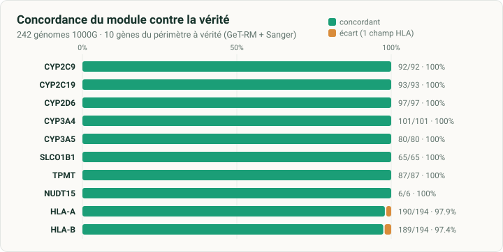
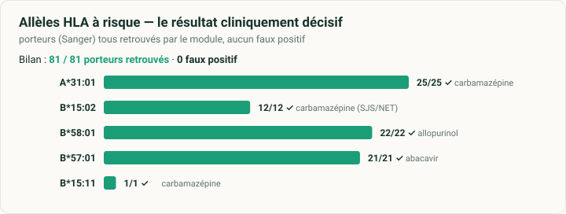
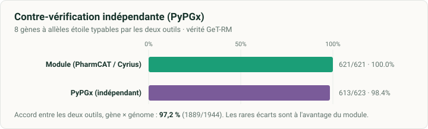
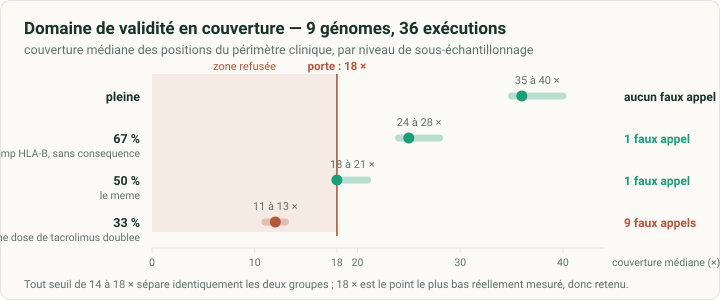

# Validation — état des preuves et protocole de revalidation

Ce document rassemble ce qui a été mesuré, ce qui ne l'a pas été, et ce qui
déclenche une revalidation. Il est destiné à être versé dans un dossier
technique.

## 1. Usage prévu

Le module rend un avis pharmacogénétique sur treize gènes du sous-ensemble
néphrologie et épilepsie du panel socle RNPGx 2026, à partir d'un alignement et
d'un fichier de variants **produits en amont par la plateforme**.

| | |
|---|---|
| Entrées | alignement CRAM ou BAM sur GRCh38, fichier de variants mono-échantillon, référence indexée |
| Sorties | avis structuré (`report.json`), compte rendu en français (`CR_<ECH>.pdf`), trace d'exécution (`provenance.json`) |
| Ne fait pas | ni séquençage, ni alignement, ni appel de variants, ni validation biologique |
| Décision finale | un biologiste médical ; le compte rendu porte sa ligne de validation |

## 2. Conditions d'emploi mesurées

| Condition | Valeur | Origine |
|---|---|---|
| Assemblage | GRCh38, la référence ayant servi à l'alignement | contrôlé à l'étage 0 |
| Profondeur | ≥ 10× par position diagnostique | seuil par défaut |
| Couverture | médiane ≥ 18 × sur les positions du périmètre clinique | 36 exécutions ; **sous le seuil le génome est refusé**, voir 3.4 |
| Pureté de l'échantillon | part d'hétérozygotes déséquilibrés ≤ 35 % | 229 exécutions ; **au-delà l'échantillon est refusé**, voir 3.7 — un mélange de 20 % n'est pas détecté |
| Qualité de génotype | GQ ≥ 20 | seuil par défaut, **voir la limite 4.3** |
| Équilibre allélique | ≥ 0,25 pour un hétérozygote, hors CYP2D6 | mesuré sur 105 génomes |
| Parallélisme en lot | jusqu'à 6 génomes | mesuré de 2 à 6, voir 3.10 ; au-delà, rien n'est mesuré |
| Dossier de sortie | disque local recommandé | 1 361 Mo/s contre 99 sur un disque monté ; les débits de 3.10 sont mesurés sur disque monté, donc minorants |
| Moteur de conteneurs | `docker`, éprouvé ; `apptainer` ou `singularity`, acceptés, **non éprouvés**, voir 4.8 | vérifié avant tout étage ; un moteur absent est refusé, non diagnostiqué comme une donnée fautive |
| Identité du patient | fichier, par `--identite` | un argument de ligne de commande est lisible dans la table des processus |

## 3. Preuves disponibles

### 3.1 Exactitude contre vérité indépendante

Génomes publics du 1000 Genomes (jeu haute couverture NYGC, GRCh38), vérité
GeT-RM (CDC) pour les gènes à allèles étoile, typage HLA Sanger (Gourraud
*et al.*, 2014) pour HLA-A et HLA-B. La liste des prélèvements est dans
`bench/echantillons.csv`, déduite du lot par `outils/construire_banc.py`.

| Mesure | Résultat |
|---|---|
| Concordance sur les dix gènes à vérité | **1000 / 1009 = 99,1 %** |
| Gènes à allèles étoile | 100 % sur les huit |
| HLA-A / HLA-B, deux champs | 190 / 194 et 189 / 194 |
| **Allèles HLA à risque** | **81 / 81 porteurs retrouvés, 0 faux positif** |

| Gène | Concordance | | Gène | Concordance |
|---|---|---|---|---|
| CYP2C9 | 92 / 92 | | SLCO1B1 | 65 / 65 |
| CYP2C19 | 93 / 93 | | TPMT | 87 / 87 |
| CYP2D6 | 97 / 97 | | NUDT15 | 6 / 6 |
| CYP3A4 | 101 / 101 | | HLA-A | 190 / 194 |
| CYP3A5 | 80 / 80 | | HLA-B | 189 / 194 |

POR et ABCG2 sont dans le périmètre sans vérité sur ce banc (limite 4.2) ;
MT-RNR1 n'y a aucun porteur (limite 4.1).

**Allèles HLA à risque.** La cohorte est enrichie en porteurs, surreprésentés
par rapport à leur fréquence en population.

| Allèle | Médicament | Porteurs | Retrouvés |
|---|---|---|---|
| A\*31:01 | carbamazépine | 25 | 25 |
| B\*15:02 | carbamazépine (SJS/NET) | 12 | 12 |
| B\*58:01 | allopurinol | 22 | 22 |
| B\*57:01 | abacavir | 21 | 21 |
| B\*15:11 | carbamazépine | 1 | 1 |

Les neuf écarts portent tous sur le second champ d'un allèle HLA, sans
conséquence de prescription ; ils sont détaillés en 4.4.

**Couverture des positions diagnostiques** : médiane 99,7 %, minimum 85,3 %. Aux
seuils par défaut, 88 % des couples gène × génome sont complets ; le reste est
rendu « partiel » et signalé comme tel, jamais rabattu sur une référence.

### 3.2 Robustesse de la chaîne

| Mesure | Résultat |
|---|---|
| Génomes soumis | 256 |
| Refus à l'entrée sur alignement non conforme | **13 / 13**, aucun résultat produit : 12 alignements tronqués, 1 sur un autre assemblage |
| Génomes recevables menés au bout | **242 / 243** ; le dernier porte un échec CYP2D6 isolé, signalé comme tel |
| Non-régression entre deux versions | **2 673 diplotypes, 0 écart** |
| Garde-fous de l'étage 4b exercés sur donnée réelle | 5 / 5, chacun refusant le seul gène concerné |
| **Répétabilité** | 3 exécutions indépendantes d'un même génome, **29 éléments comparés, 0 écart** |
| Reprise d'une exécution interrompue | résultat identique ; le typage HLA est réutilisé, 201 s → 2 s |

### 3.3 Typage complémentaire et contre-vérification par un second outil

**Typage complémentaire.** 243 génomes. Aucune vérité externe n'existe pour ces
quatre gènes ; la mesure de référence est le génotype relevé position par
position par le contrôle qualité, sur un chemin technique indépendant — l'un lit
l'alignement et sa profondeur, l'autre le seul fichier de variants.

Le fichier de variants disponible pour le banc ne couvrait que les régions de
l'interpréteur : pour les régions des quatre gènes et du complément RNPGx, les
génotypes ont été appelés depuis l'alignement par bcftools et ajoutés au fichier
de la plateforme, qui reste seul sur ses propres régions. Les douze gènes de
l'interpréteur sont donc validés sur les appels de la plateforme (GATK), et
ces quatre gènes sur des appels bcftools. Une plateforme fournit un fichier
couvrant le génome entier, contig mitochondrial compris, et n'a rien à ajouter.

| Gène | Rendus | Non conclusifs | Concordance avec la mesure |
|---|---|---|---|
| MT-RNR1 | 242 / 243 | 1 (contig `chrM` absent du fichier de variants) | **aucun porteur sur ce banc** |
| BCHE | 243 / 243 | 0 | 243 / 243 sur ses deux positions |
| MTHFR | 243 / 243 | 0 | 243 / 243 sur C677T et A1298C |
| POR | 243 / 243 | 0 | 243 / 243 sur `rs1057868` |

Les fréquences alléliques observées rejoignent les valeurs publiées : BCHE
`rs1803274` 0,18 contre 0,20 attendu, MTHFR C677T 0,35 contre 0,33. Le gène non
conclusif est le comportement voulu : sans le contig mitochondrial dans le
fichier de variants, le typeur rendrait « référence » — donc « risque normal de
surdité sous aminoside » — sur un gène jamais lu.

**L'appel positif de MT-RNR1 est exercé par un cas construit.** Un fichier de
variants portant `m.1555A>G` en homoplasmie traverse la chaîne entière :
l'étage le type, l'allèle part en appel externe, l'interpréteur rend « risque
augmenté de surdité sous aminoside », **onze recommandations CPIC fortes** sont
générées, et la consigne « éviter les aminosides » figure au compte rendu avec
les onze molécules. Cela valide la chaîne logicielle, **non la détection** :
l'alignement ne porte pas le variant (`outils/cas_construit.py`).

**Contre-vérification par un second outil.** Les gènes à allèles étoile que
PyPGx sait typer ont été appelés en parallèle par PyPGx sur les mêmes entrées,
avec le nombre de copies pour CYP2D6 calibré sur le gène de contrôle VDR. Les
deux outils s'accordent sur **97,2 %** des couples. Contre la vérité GeT-RM, le
module est à **100 % (621 / 621)** et PyPGx à **98,4 % (613 / 623)** ; les écarts
sont à l'avantage du module (CYP2D6, SLCO1B1, NUDT15), qui s'abstient ou tranche
par classe de fonction là où PyPGx force un appel. En sens inverse, PyPGx type
POR — 129 porteurs de `*28` sur 244 — que l'interpréteur ne couvre pas : c'est
ce constat qui en a fait un étage du module.

### 3.4 Domaine de validité en couverture

L'alignement est sous-échantillonné, les variants rappelés depuis l'alignement
réduit — sans quoi seule la mesure de profondeur changerait, pas les génotypes —
puis le module repasse en entier. **9 génomes, 36 exécutions.** Les niveaux sont
des fractions ; la profondeur indiquée est celle que le module mesure lui-même.

| Couverture | Profondeur médiane | Gènes complets | partiels | absents |
|---|---|---|---|---|
| pleine | 34 × | 9,0 | 0,0 | 0,0 |
| 67 % | 24 × | 8,4 | 0,6 | 0,0 |
| 50 % | 17 × | 5,2 | 3,7 | 0,1 |
| 33 % | 11 × | 1,0 | 7,6 | 0,4 |

Un changement de diplotype n'a pas la même portée selon sa nature. Une
abstention et une ambiguïté sont rendues comme telles et ne déclenchent aucune
recommandation ; un appel unique et différent, lui, affirme.

**Dans le périmètre clinique — les treize gènes que le compte rendu restitue :**

| Couverture | Faux | Abstentions | Ambiguïtés |
|---|---|---|---|
| 67 % | **1** | 0 | 0 |
| 50 % | **1** | 1 | 1 |
| 33 % | **9** | 5 | 5 |

**Le seul faux appel à 24 × et à 17 × est le même génome et le même gène** :
HLA-B rendu `*45:04/*57:01` au lieu de `*45:01/*57:01`. C'est un second champ,
et **l'allèle à risque `*57:01` est préservé** — la faiblesse déjà déclarée en
4.4, devenue visible quand la couverture baisse, et sans conséquence de
prescription.

**À 11 ×, neuf faux appels apparaissent**, dont huit de la même forme : un
allèle variant lu comme référence.

| Génome | Gène | Pleine couverture | À 11 × |
|---|---|---|---|
| HG00101, HG00142 | CYP3A5 | `*3/*3` | `*1/*1` |
| HG00131 | CYP3A5 | `*1/*3` | `*1/*1` |
| HG00111 | CYP3A4 | `*1/*22` | `*1/*1` |
| HG00122 | CYP3A4 | `*1/*10` | `*1/*1` |
| HG00122 | SLCO1B1 | `*1/*20` | `*1/*1` |
| HG00131 | SLCO1B1 | `*1/*14` | `*1/*1` |
| HG00118 | CYP2D6 | `*1/*41` | `*34/*119` |

La conséquence est vérifiée jusqu'à la conduite à tenir, et non supposée :

| Couverture | CYP3A5 | Phénotype | Conduite pour le tacrolimus |
|---|---|---|---|
| 34 × | `*3/*3` | métaboliseur lent | dose standard |
| 11 × | `*1/*1` | métaboliseur normal | **augmenter la dose initiale de 1,5 à 2 fois** |

À 11 ×, le compte rendu recommanderait donc de doubler la dose de tacrolimus
chez un patient qui est en réalité métaboliseur lent. Deux génomes sur neuf.

**À la couverture du banc, en revanche, le masquage n'a aucune conséquence
clinique.** Mesure directe : pour chaque gène du périmètre portant une position
masquée, l'interpréteur a été relancé sur le fichier non masqué, les appels
externes fournis des deux côtés.

| Mesure | n |
|---|---|
| Couples gène × génome avec une position masquée | 35 |
| Diplotype inchangé | 25 |
| Devenu une ambiguïté **contenant** l'appel non masqué | 9 |
| Devenu un appel unique différent | **1** |

Les neuf ambiguïtés sont le garde-fou qui fonctionne : la position masquée
aurait discriminé, et le module refuse de choisir — un gène ambigu ne déclenche
aucune recommandation. Le seul appel différent, SLCO1B1 `*1/*1` au lieu de
`*1/*37`, porte **le même phénotype, fonction normale, et les sept mêmes
recommandations de statines**.

**Conséquence : le domaine de validité s'arrête au niveau 50 %**, qui mesure
18 × sur les positions du périmètre clinique et 17 × sur le panel entier.
Jusque-là, aucun allèle à conséquence clinique n'est perdu.

**Le module refuse un génome hors de ce domaine.** Le contrôle qualité mesure la
couverture médiane des positions du périmètre sur l'alignement ; sous le seuil,
le génome est refusé — code de sortie 2, aucun document produit. Le refus plutôt
que l'avertissement : rien, dans le compte rendu, ne distinguerait un appel
fondé sur une position lue d'un appel fondé sur une position supposée.

Le seuil est placé par la mesure, sur les mêmes 36 exécutions :

| Niveau | Couverture médiane du périmètre | Faux appels | Porte |
|---|---|---|---|
| pleine | 35 à 40 × | 0 | accepté |
| 67 % | 24 à 28 × | 1, sans conséquence de prescription | accepté |
| 50 % | 18 à 21 × | 1, le même | accepté |
| 33 % | 11 à 13 × | **9** | **refusé, 9 sur 9** |

Tout seuil de 14 à 18 × sépare identiquement les deux groupes. **18 × est
retenu** : c'est le point le plus bas réellement mesuré, et le seuil
n'extrapole donc pas sous lui. `--couverture-min 0` lève la porte ; la
couverture mesurée et le seuil appliqué figurent dans la trace et sur le compte
rendu.

Hors périmètre, l'interpréteur rend dix autres gènes, mesurés mais non
rapportés : ils accusent un faux appel à 17 × et treize à 11 ×. Ces changements
n'atteignent pas le compte rendu, et c'est une raison de plus de ne pas les
rapporter.

**Ce que ces faux appels enseignent sur le mécanisme.** Les positions fautives
avaient bien été écartées par le contrôle qualité, qui écrit `./.` pour dire
qu'il ne leur fait pas confiance. Mais le préprocesseur de l'interpréteur
**supprime l'enregistrement**, et l'interpréteur suppose alors la référence.
Réinjecter le `./.` après le prétraitement ne change rien : l'interpréteur
l'ignore. Et `--absent-to-ref` ne peut pas être retiré — sans lui, 15 gènes sur
23 sortent indéterminés, parce que l'interpréteur a besoin de bien plus de
positions que les 1 226 mesurées par le module.

**Il n'existe donc aucun canal, par cette interface, pour signaler à
l'interpréteur qu'une position précise n'est pas fiable.** Le module ne peut
agir que dans son propre rendu : il déclare le gène « partiel » et affiche
désormais la proportion de positions perdues. Un gène dont une part notable des
positions manque ne doit pas fonder une décision de posologie.

### 3.5 Indépendance à l'appeleur de variants

**243 génomes**, mêmes alignements, mêmes positions, appel par l'appeleur de
la plateforme (GATK) et par bcftools. Les génotypes sont comparés en bases et
non en indices d'allèles : les deux fichiers n'ont pas la même liste d'ALT, et
comparer les indices fabriquerait des désaccords qui n'en sont pas.

| Mesure | Résultat |
|---|---|
| Concordance des génotypes | **103 604 / 103 683 = 99,924 %** |
| Localisation des 79 écarts | CYP2D6 (59) ; CYP4F2 (18) ; NAT2 (1) ; CYP2B6 (1) |
| Écarts sur un gène rendu depuis le fichier de variants | **0** |

Les régions concernées sont les régions paralogues du périmètre, déjà
traitées à part : CYP2D6 est appelé par un outil dédié sur l'alignement
complet, les autres sont hors périmètre clinique. Les écarts ne sont pas
dispersés : `rs3915951` (CYP2D6) chez 26 génomes ; `rs1058172` (CYP2D6) chez 16 génomes ; `rs4020346` (CYP4F2) chez 15 génomes.

**Le seuil GQ ≥ 20 prend-il la même décision ?** La mesure ne portait
jusqu'ici que sur les positions où bcftools écrit un GQ, soit une quinzaine par
génome. Or le GQ est l'écart entre la deuxième meilleure vraisemblance et la
meilleure, et `mpileup` produit des PL sur **toutes** les positions. La
déduction est vérifiée avant d'être utilisée :

| Côté | Positions | GQ déduit égal au GQ écrit | Même décision au seuil |
|---|---|---|---|
| plateforme, ses propres PL | 106 358 | **99,99 %** | — |
| bcftools, PL de `mpileup` contre GQ de l'appel | 4 269 | 71,98 % | **99,91 %** |

Le GQ déduit n'est pas numériquement identique au GQ écrit par bcftools —
l'appeleur y ajoute son a priori — mais il prend la même décision au seuil. La
mesure passe ainsi de 374 à **103 683 positions**.

| Plateforme | bcftools | n | part |
|---|---|---|---|
| retenue | retenue | 102 872 | 99,218 % |
| écartée | retenue | 719 | 0,693 % |
| écartée | écartée | 49 | 0,047 % |
| retenue | écartée | 43 | 0,041 % |

**762 positions sur 103 683 changent de décision, soit 0,735 %.** Elles se
concentrent sur CYP2B6 (477) ; SLCO1B1 (151) ; CYP2D6 (86).

Une bascule ne change le rendu que si l'un des deux appeleurs lit un **variant**
à cette position : une position écartée est supprimée par le prétraitement et
l'interpréteur suppose alors la référence, donc une référence retenue d'un
côté et écartée de l'autre donne le même résultat. Le critère porte sur les
deux génotypes : dans un sens le module verrait un allèle qu'il ne voyait pas,
dans l'autre il en perdrait un.

**42 bascules sur 762 portent un variant, et toutes sur
CYP2D6 et CYP4F2 — appelés hors du fichier de variants ou hors
périmètre. Aucune n'atteint donc le compte rendu.** Sur SLCO1B1, où se
concentrent 151 bascules, aucune ne porte un variant : `rs71581941` est une
position où l'appeleur de la plateforme n'a aucune confiance et où l'autre lit
une référence, ce que l'interpréteur suppose de toute façon.

**Vérification sur le rendu, et non sur la seule position.** 29 génomes passés
en entier des deux côtés, 232 couples gène × génome sur les huit gènes que
l'appeleur peut atteindre.

| Niveau | Identique | Différent |
|---|---|---|
| diplotype | 226 | **6** |
| phénotype | 232 | **0** |
| recommandations | 232 | **0** |

Les six écarts sont tous sur SLCO1B1 et tous de la même forme : le fichier de la
plateforme donne une **ambiguïté** (`*1/*15;*1/*45`) là où celui de bcftools
tranche pour **un membre de cette même ambiguïté** (`*1/*15`). Vérifié les six
fois : aucun appel ne sort de l'ensemble proposé par l'autre côté. C'est
`rs71581941` — sans confiance chez l'appeleur de la plateforme, donc masquée, et
le module refuse alors de choisir ; lue avec confiance par l'autre, elle
discrimine.

Le sens de l'écart mérite d'être noté : sur le fichier de la plateforme, le
module est **plus prudent, pas moins juste**. Le phénotype et les
recommandations sont identiques dans les six cas.

Un échantillon de 9 génomes donnait 72 couples sur 72 identiques et ne montrait
aucun de ces six écarts : c'est la raison de l'avoir étendu.

**Ce que la comparaison ne couvre pas.** 2 190 positions, environ 9 par génome, portent une référence différente d'un fichier à l'autre — des indels ancrés sur une autre base — et sont hors comparaison : c'est là que deux appeleurs divergent le plus. 350 positions portent plusieurs enregistrements, et c'est l'enregistrement appelé qui est retenu, comme à l'étage de contrôle.

### 3.6 Vérification du code

| Mesure | Résultat |
|---|---|
| Cas de test | 245 |
| Audit par mutation, cumulé sur les versions | **79 défauts réintroduits, 79 suites en échec, 0 mutation survivante** |
| Contrôles d'intégrité du dépôt | 4 fautes réintroduites, 4 attrapées |
| Reproductibilité du catalogue généré | 3 régénérations, **même empreinte**, égale au fichier livré |

**Deux défauts ont été trouvés par ces contrôles eux-mêmes**, et non par
relecture. Le générateur de catalogue n'était pas déterministe : deux positions
de même coordonnée changeaient de place selon l'ordre d'itération d'un
ensemble. Et la réutilisation du typage HLA lors d'une reprise ne vérifiait pas
l'image qui l'avait produit — une montée de version du typeur suivie d'une
reprise aurait rendu l'ancien résultat sans rien signaler. Les deux sont
corrigés.

### 3.7 Spécificité à un mélange d'échantillons

Deux génomes du banc, choisis parce qu'ils diffèrent sur **les huit gènes**
rendus depuis le fichier de variants. Les lectures du contaminant sont injectées
dans celles de l'hôte à fraction croissante, sous une seule identité — une
contamination réelle précède le séquençage. Témoin : le mélange à 0 %, même
chaîne.

| Contaminant | Faux hétérozygotes | Diplotype changé | Document rendu |
|---|---|---|---|
| 0 à 10 % | 0 à 1 | 0 | **identique** |
| 20 % | 5 | 1 | ABCG2 `Unknown/Unknown`, **le module s'abstient** ; la rosuvastatine apparaît |
| 30 % | 10 | 1 | ABCG2 `G/T` au lieu de `T/T`, **faux appel unique** ; phénotype différent |

**En deçà de 10 %, aucune conséquence.** À 20 %, le garde-fou d'équilibre
allélique se déclenche et le gène sort indéterminé — mais une recommandation
apparaît au document, qui ne s'y trouve pas pour l'échantillon pur. À 30 %, le
garde-fou est défait : la fraction de l'allèle mineur ressemble à celle d'un
hétérozygote vrai, et le module rend un appel unique faux.

**Un garde-fou par position ne peut donc pas suffire**, et un indicateur
d'ensemble est ajouté : la part des hétérozygotes appelés dont l'allèle mineur
est soutenu par moins de 30 % des lectures.

| Mesure | Part déséquilibrée |
|---|---|
| 229 exécutions du lot, échantillons purs | médiane 7,7 %, 99ᵉ centile 22,5 %, **maximum 31,9 %** |
| mélange à 10 % | 12,5 % |
| mélange à 20 % | 25,0 % |
| mélange à 30 % | **41,5 %** |

Le seuil est posé à **35 %** : il laisse passer les 229 échantillons purs avec
de la marge et arrête le mélange à 30 %. Le témoin, appelé par bcftools quand le
lot l'est par GATK, mesure 7,7 % — exactement la médiane du lot : l'appeleur ne
déplace pas l'indicateur, et les deux mesures se comparent.

**Ce que la porte ne voit pas, et qui doit être dit.** Le mélange à 20 % mesure
25,0 %, dans l'étendue des échantillons purs. Ce n'est pas un réglage à affiner :
sur la quarantaine de positions hétérozygotes que l'étage lit, les quatre
statistiques essayées — part déséquilibrée, fraction médiane, premier quartile,
fraction moyenne — placent toutes le mélange à 20 % à l'intérieur de la
distribution des 229 échantillons purs. L'information n'y est pas.

**La détection d'un mélange reste donc à faire en amont**, sur le génome entier,
par l'outil de la plateforme. La porte du module arrête un mélange grossier ;
elle ne remplace pas ce contrôle, et le déclarer autrement donnerait une fausse
assurance.

Réserve : un seul couple hôte–contaminant, non apparentés. Un contaminant
apparenté partage davantage de génotypes et produirait un indicateur plus bas à
fraction égale.

### 3.8 Non-régression

Chaque changement qui ne devrait pas modifier un résultat rendu est vérifié par
le rejeu de génomes du lot sur **les mêmes entrées**, comparé aux rapports
conservés par `outils/comparer_rapports.py` — diplotype, phénotype,
recommandations ; un génome repassé sans rapport est un écart. « Ne devrait
pas » n'est pas une mesure.

| Changement | Génomes | Couples gène × génome | Écarts |
|---|---|---|---|
| Portes de couverture et de mélange, couverture au compte rendu | 5 | 60 | **0** |
| Exécution étage par étage, recette Nextflow (3.9) | 30 | 720 | **0** |
| Déclaration de la mémoire par étage | 3 | 36 | **0** |
| Conteneurs sous l'identité de l'appelant, typeur dans son image, verrou par hôte | 3 | 36 | **0** |

**Témoin négatif.** Un alignement réduit à 1 % de ses lectures est refusé par la
porte de couverture, sans compte rendu : un échantillon presque vide ne ressort
pas avec une réserve, il ressort refusé.

### 3.9 Exécution étage par étage

`--etage` fait tourner chaque étage seul, pour qu'un ordonnanceur alloue ses
ressources étage par étage et relance un étage sans rejouer les autres. C'est le
même code que l'exécution complète ; il est éprouvé sur génomes réels.

| Épreuve | Résultat |
|---|---|
| Exécution complète, contre le lot | **0 écart** sur 12 couples gène × génome |
| Étage par étage, CYP2D6, HLA et typage complémentaire en parallèle | **0 écart**, réussite complète |
| Recette Nextflow, deux génomes | **0 écart** sur 24 couples |
| Recette Nextflow, lots de dix génomes, à froid et déjà lus | **0 écart** sur 240 couples |
| Refus : dossier sans recevabilité, entrées changées, génome refusé en amont, étage déjà en cours | **7 codes sur 7** attendus |
| Verrou posé depuis un autre hôte | jamais repris, code 3 ; repris sur le même hôte si son processus est mort |
| Recette Nextflow, alignement tronqué | refusé, sorti de la chaîne, porté au bilan |
| Table d'états écrite par trois étages simultanés | aucune ligne entrelacée |
| Audit par mutation | 11 défauts réintroduits, aucun survivant |

Sur un génome seul, le gain de temps est modeste : les trois étages
indépendants sont bornés par le typage HLA, et le trio passe de 269 à 212
secondes. Sur un lot, la recette mène plus de génomes de front que le lanceur
de lot ; voir 3.10.

### 3.10 Débit et mémoire

Mesuré sur ce banc — vingt-quatre cœurs, disque dur monté sous WSL2 — sur des
lots de dix génomes. À froid : des génomes qu'aucun essai n'avait lus. Déjà
lus : les mêmes dix génomes pour tous les modes, ce qui retire le cache disque
de la comparaison.

| Mode | À froid | Déjà lus |
|---|---|---|
| Recette Nextflow, exécuteur local | **51,4 génomes/h** | 55,6 |
| Lot à 6 | 38,8 | 51,5 |
| Lot à 4, réglage par défaut | — | 39,0 |
| Lot à 2 | — | 23,7 |

Chaque passage rend les mêmes diplotypes, phénotypes et recommandations que le
lot de référence : **0 écart sur 720 couples** gène × génome.

Un génome coûte 351 secondes de processeur pour 270 secondes de durée, soit 1,3
cœur en moyenne ; le typage HLA en occupe 1,1 pendant 145 secondes. Le débit
tient donc au nombre de génomes menés de front, et ce banc est borné par son
disque : à froid, la recette n'occupe que 5,8 cœurs sur 24.

Deux corrections viennent de cette mesure :

| Avant | Mesuré | Correction |
|---|---|---|
| OptiType sur seize fils, fixés par la configuration de son image | à quatre fils, même typage sur 10 génomes sur 10, même durée à 2 s près, 18 % de processeur en moins | le module lui passe `--fils` ; le lot à six, qui tombait à un génome en 45 minutes, rend 38,8 génomes/h à froid |
| La recette réservait seize cœurs au HLA | il en occupe 1,1 ; l'exécuteur faisait passer les typages un par un, à 16,8 génomes/h | chaque étage déclare sa consommation mesurée, transmise au module comme nombre de fils |

Le passage d'OptiType à quatre fils a été éprouvé sur trente génomes distincts,
sans un écart de rendu.

**Mémoire.** Mesurée étage par étage sur trois génomes, dont le pire cas des 242
du lot de validation : le plus de lectures HLA (234 Mo contre 154 en médiane)
et la plus forte couverture (57 × contre 35 ×). La recette déclare la pointe
avec une marge de moitié au moins, ou la borne que l'outil se fixe lui-même :

| Processus | Pointe | Déclaré | Fondement |
|---|---|---|---|
| ouverture | 0,9 Go | 2 Go | samtools trie sur 768 Mo par fil au plus |
| contrôle qualité | 0,1 Go | 1 Go | |
| CYP2D6 | 0,65 Go | 1 Go | |
| HLA | 1,9 Go | 3 Go | typage identique sous 3 Go, sur les deux génomes les plus gourmands |
| typage complémentaire | 0,7 Go | 3 Go | PyPGx lance Beagle avec un tas de 2 Go |
| interprétation | 1,6 Go | 2 Go | PharmCAT rend le même avis sous 1 Go, et échoue sous 512 Mo |

Ainsi déclarée, la recette rend sur ces trois génomes les mêmes 36 couples que
le lot de validation. Sous Docker, les conteneurs échappent à la mémoire
réservée à la tâche ; sous Apptainer, ils y restent tenus.

## 4. Limites connues, à déclarer

**4.1 MT-RNR1 n'a aucun porteur sur le banc.** Ses trois positions du panel sont
de référence sur les 243 génomes. Le gène porte pourtant toute la valeur
clinique du typage complémentaire, puisqu'il est le seul à rendre un phénotype
et une recommandation. L'appel négatif est vérifié 242 fois ; l'appel positif
l'est par un cas construit (`outils/cas_construit.py`), qui valide la chaîne
logicielle et non la détection. **Un matériau de référence porteur reste
nécessaire.**

**4.2 POR et ABCG2 sont rendus sans vérité.** Aucun matériau de référence du
banc ne les porte : GeT-RM couvre 41 gènes, et ni l'un ni l'autre. Ce qui est
mesurable à défaut de vérité :

| | ABCG2 `rs2231142` | POR `rs1057868` |
|---|---|---|
| Position lue | **243 / 243** | **243 / 243** |
| Profondeur médiane | 33 × | 53 × |
| GQ médian | 96 | 127 |
| Deux appeleurs indépendants | **243 / 243 concordants** | hors du fichier de variants |
| Hétérozygotes, part de l'allèle mineur | 45, médiane 0,448, minimum 0,312 | — |
| Génotypes observés | 78 % / 19 % / 3 % | 47 % / 46 % / 7 % |

ABCG2 est appelé depuis le fichier de variants, et les deux appeleurs s'accordent
sur les 243 génomes ; ses hétérozygotes sont équilibrés, ce qui exclut la perte
d'un allèle. POR vient du typage complémentaire, dont la concordance position par
position est établie en 3.3 ; sa position de classe 2 est mesurée, jamais
interprétée.

**Ce que cela ne prouve pas.** Deux appeleurs qui s'accordent peuvent se tromper
ensemble, et une lecture équilibrée à bonne profondeur n'établit pas le bon
allèle. Ces mesures excluent les modes de défaillance connus — perte d'allèle,
position non lue, qualité insuffisante — elles ne remplacent pas un matériau de
référence. L'écart à l'équilibre de Hardy-Weinberg n'est pas utilisable ici : la
cohorte mêle des populations où la fréquence de `rs2231142` varie fortement, et
la structure de population suffit à l'expliquer.

**4.3 Le seuil GQ ≥ 20 est mesuré sur deux appeleurs, pas sur tous.** Le GQ n'a
pas la même échelle d'un appeleur à l'autre : plafond 99 pour GATK, 127 pour
bcftools. Sur 103 683 positions et 243 génomes, aucun écart de décision
n'atteint le compte rendu (§ 3.5). **La réserve porte sur les familles non
mesurées** — DRAGEN et DeepVariant — et sur les positions dont la référence
s'écrit autrement, hors comparaison.

Trois positions méritent une vérification sur l'appeleur de la plateforme
d'accueil, parce que leur décision change déjà entre les deux appeleurs
mesurés : `rs186335453` et `rs36060847` (CYP2B6, hors périmètre clinique) et
`rs71581941` (SLCO1B1, 62 % des génomes). Aucune ne porte de variant sur ce
banc, et c'est pourquoi aucune n'y a de conséquence ; sur un autre appeleur,
cela se vérifie plutôt que de se supposer.

**4.4 Le second champ des allèles HLA vacille sur A\*02 et B\*27.** Les neuf
écarts du banc, tous « un allèle sur deux », le premier champ — celui qui porte
le risque — restant résolu :

| Prélèvement | Gène | Module | Vérité Sanger | Allèle discordant |
|---|---|---|---|---|
| NA18552 | HLA-A | \*02:07 / \*11:01 | \*02:01 / \*11:01 | 02:07 vs 02:01 |
| NA18966 | HLA-A | \*02:06 / \*02:07 | \*02:01 / \*02:06 | 02:07 vs 02:01 |
| NA18980 | HLA-A | \*11:02 / **\*31:01** | \*11:01 / **\*31:01** | 11:02 vs 11:01 — **A\*31:01 juste** |
| NA19007 | HLA-A | \*02:07 / \*26:03 | \*02:01 / \*26:03 | 02:07 vs 02:01 |
| HG01190 | HLA-B | \*18:01 / \*35:28 | \*15:20 / \*18:01(/18:17N) | 35:28 vs 15:20 |
| NA10854 | HLA-B | \*27:05 / \*44:02 | \*44:02 / \*27:03 | 27:05 vs 27:03 |
| NA11832 | HLA-B | \*27:05 / \*40:02 | \*40:02 / \*27:03·09·51·52 | 27:05 vs 27:0x, **vérité ambiguë** |
| NA19327 | HLA-B | \*45:01 / \*82:02 | \*45:01·45:07 / idem | 82:02 vs 45:07, **vérité ambiguë** |
| NA19917 | HLA-B | \*08:01 / \*15:03 | \*15:03·15:103 / \*41:02 | 08:01 vs 41:02 |

Ils se concentrent sur les familles A\*02 et B\*27, dont les sous-types ne
diffèrent que de un à deux SNP, souvent hors des exons typés par OptiType, sur
une référence GRCh38 linéaire pour une région multi-haplotype ; deux des vérités
Sanger sont elles-mêmes ambiguës. Aucun impact de prescription.

**4.5 Les traductions des recommandations CPIC n'ont pas de validation
pharmacologique.** La table en compte 66, dont **51 sont effectivement rendues**
sur le banc ; aucun texte rendu n'est laissé sans traduction.
`outils/fiche_traductions.py` produit la fiche de relecture — texte d'origine,
traduction, médicament, gène, nombre de comptes rendus concernés, et une colonne
de visa — classée par usage, pour que la relecture commence par ce qui sert. Les
15 entrées qu'aucun compte rendu n'emploie y figurent à part : l'avertissement
sur les aminosides en tête, faute de porteur de MT-RNR1 (limite 4.1).

**4.6 Un mélange d'échantillons de 20 % n'est pas détecté par le module.** Il
modifie le document rendu (§ 3.7). Sur les positions que le module lit,
l'information n'existe pas : **un contrôle de contamination sur le génome entier
reste nécessaire en amont.**

**4.7 Aucun contrôle de qualité externe.** Une participation à un programme
(EMQN, GenQA) reste à organiser.

**4.8 Apptainer n'a pas été exécuté sur ce banc.** Le module l'accepte — image de
dépôt ou fichier `.sif`, dont l'empreinte est tracée — mais toutes les mesures de
ce dossier sont faites sous Docker. Une plateforme qui l'emploie rejoue le génome
de qualification sous ce moteur avant tout autre usage (`doc/MODE_EMPLOI.md`,
§ 11). Sous Docker même, deux points tiennent à l'installation et non au module :
les conteneurs tournent sous l'identité de l'appelant, et ils échappent à la
mémoire réservée par un ordonnanceur à la tâche.

## 5. Protocole de revalidation

Toute version des outils et des tables est figée dans `provenance.json` par
empreinte immuable, non par étiquette : un compte rendu ancien est rejouable à
l'identique, tables cliniques comprises.

### 5.1 Déclencheurs

| Changement | Revalidation |
|---|---|
| Version d'une image (interpréteur, HLA, bcftools, typeur complémentaire) | complète |
| Tables cliniques CPIC embarquées | complète |
| Dépôt de l'appeleur CYP2D6, ressource de données du typeur complémentaire | complète |
| Une ressource de `ressources/` | complète |
| Un seuil par défaut | complète |
| Code d'un étage | suite de tests, puis non-régression (3.8) |
| Appeleur de variants en amont, ou plateforme d'accueil | **concordance inter-appeleur et seuil de qualité**, section 3.5 ; génome de qualification, `doc/MODE_EMPLOI.md` § 11 |

### 5.2 Procédure

1. `python -m unittest discover -s tests` et `python outils/verifier_depot.py`
   doivent passer. Le crochet `pre-push` les impose.
2. Rejouer le banc complet et comparer les diplotypes gène par gène à
   l'exécution précédente, par `outils/comparer_rapports.py`. Un écart n'est pas
   un échec : c'est un élément à instruire, dont la matérialité clinique se juge
   au cas par cas.
3. Consigner dans le dossier technique : les empreintes d'images, le nombre de
   diplotypes comparés, le nombre et la nature des écarts.
4. Si un écart touche une recommandation forte ou modérée, la décision de
   diffuser la nouvelle version appartient au biologiste responsable.

### 5.3 Ce que le dépôt fournit pour l'exécuter

| Outil | Rôle |
|---|---|
| `tests/` | 247 cas, audités par mutation |
| `outils/verifier_depot.py` | intégrité des figures, cohérence du périmètre et des comptes annoncés, syntaxe des scripts, reproductibilité des ressources générées |
| `outils/cas_construit.py` | exercice d'un allèle absent de la cohorte |
| `outils/fiche_traductions.py` | fiche de relecture des traductions, classée par usage, avec les entrées inemployées à part |
| `outils/comparer_rapports.py` | compare deux exécutions — diplotype, phénotype, recommandations, rapport manquant — et rend un code de sortie non nul au premier écart |
| `outils/construire_banc.py` | reconstruit la liste des prélèvements du banc depuis le lot et les tables de vérité |
| `bench/qualification/` | un génome public, son fichier de variants et son rapport de référence, pour qualifier une installation |
| `provenance.json` | empreintes des entrées, des images, des ressources, et seuils employés |
